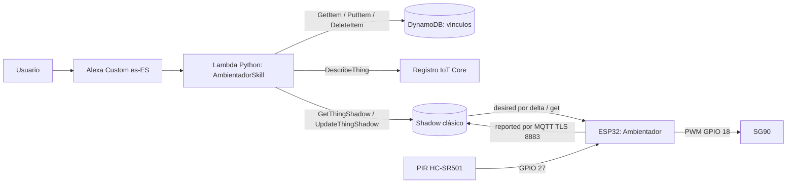
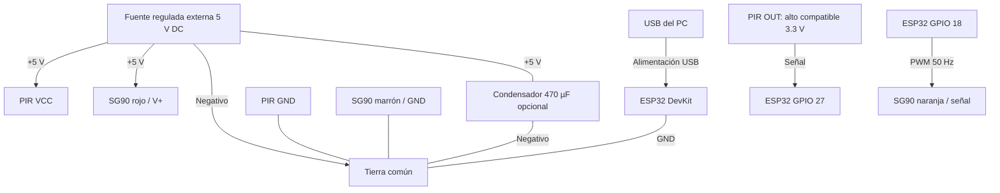
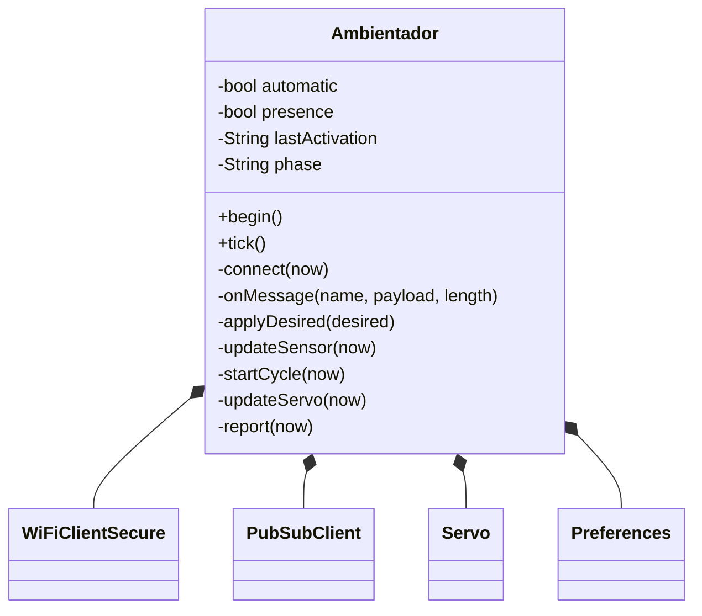
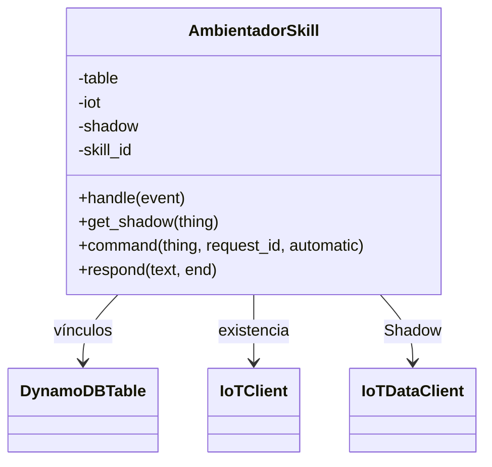
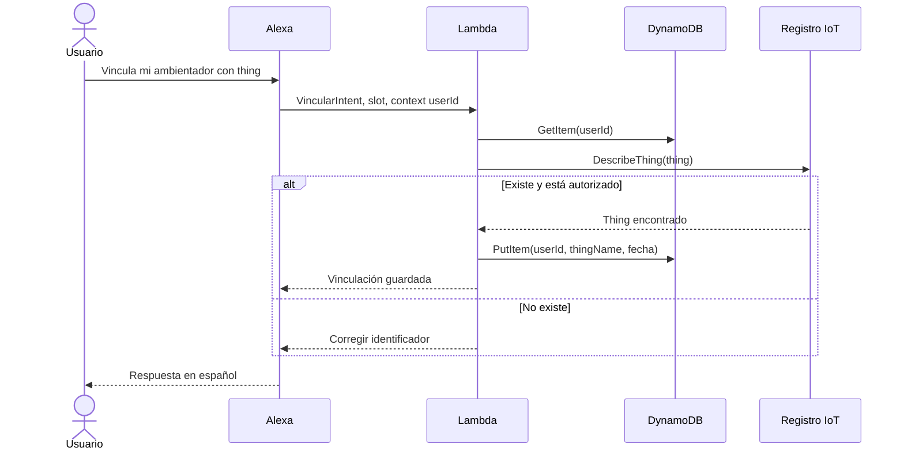
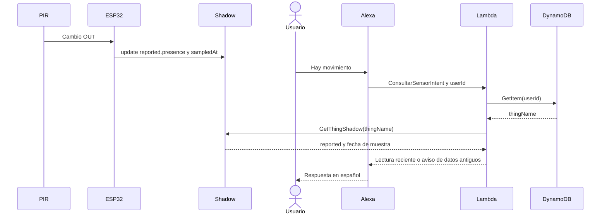
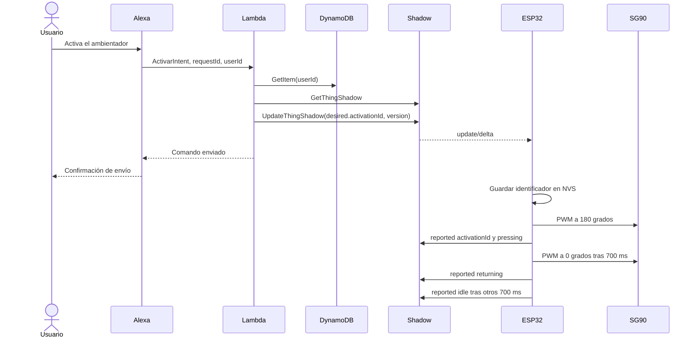

# Informe técnico — Ambientador inteligente

**Asignatura:** SIS-234. **Práctica:** 3. **Fecha de preparación:** 8 de noviembre de 2026.

**Integrantes y aportes:** pendiente de completar con nombres y commits reales.

**Revisión contra la rúbrica:** 10 de noviembre de 2026. El cumplimiento integral aún no está acreditado. La matriz de pruebas de la sección 4 identifica lo cubierto y las evidencias que todavía debe aportar el grupo.

Este documento describe la implementación existente. Los resultados medidos, funcionales y aún pendientes se distinguen en la matriz de la sección 4 y en el [registro de evidencias](../evidencias/README.md).

## 1. Caso de uso y requerimientos

Se construye la base de un ambientador que puede accionar un pulsador mediante un SG90 y detectar movimiento con un PIR HC-SR501. El usuario puede activar un ciclo desde Alexa y consultar sensor, motor y modo. La extensión automática activa al detectar un nuevo flanco de movimiento una vez transcurrido el cooldown. Para las pruebas se configura un temporizador de 5 s; para el uso del ambientador en producción se propone 60 s para reducir dispensaciones y desperdicio de fragancia. Los 60 s son una decisión prevista para producción, no el ajuste de la prueba ni una medición de consumo.

El PIR es apropiado para eventos de movimiento de personas en interiores; no mide distancia ni confirma ocupación inmóvil. El SG90 permite una acción mecánica de baja tensión con retorno al reposo. El prototipo no mide dosis, presión aplicada, cantidad de perfume ni posición física del eje. Primero se demuestra el movimiento sin acoplar un aerosol real; una aplicación final requiere calibración mecánica y validación del dispensador.

El cooldown automático se mide con `millis()` sin bloquear el loop: se inicia al comenzar un ciclo y el siguiente ciclo automático solo puede empezar ante un nuevo flanco HIGH si ya transcurrieron 5000 ms, el servo está en reposo y el Shadow está sincronizado. Por ello, mantener HIGH no genera ciclos repetidos; después del cooldown se requiere un nuevo flanco. Los 5 s se usan para agilizar pruebas y observar el comportamiento. Para producción se propone 60 s para reducir activaciones y desperdicio de fragancia; es una decisión de diseño futura, no un valor medido de consumo.

**Diferencia respecto a la consigna:** la práctica limita el actuador al control exclusivamente por voz. El código incluye una extensión automática, desactivada al arranque pero recuperable desde desired. Habilitarla por voz no convierte cada activación posterior por PIR en un comando de voz. Esta extensión no acredita cumplimiento estricto: para la entrega debe retirarse o inhabilitarse la activación por sensor y actualizar código, modelo y pruebas, o adjuntarse una autorización explícita del docente. No basta con ocultarla en el informe ni con el valor inicial false.

### Trazabilidad funcional

| Requisito | Implementación y evidencia prevista |
|---|---|
| RF1: capturar sensor | `Ambientador.updateSensor`, PIR digital; P01 |
| RF2: reportar sensor y actuador | `report`, cada cambio y cada 15 s; P02 |
| RF3: aplicar delta y confirmar | `onMessage`, `applyDesired`, `report`; pruebas de activación y reconexión |
| RF4: consulta sensor en español | `ConsultarSensorIntent`, reported; P04 |
| RF5: comando actuador por desired | `ActivarIntent`, `command`; activación documentada en AL01 |
| RF6: consulta actuador | `ConsultarMotorIntent`; P05 |
| RF7: vinculación persistente | `VincularIntent`, PutItem en DynamoDB; P06 |
| RF8: resolver usuario en cada solicitud | `context.System.user.userId`, GetItem consistente |
| RF9: validar/cambiar/eliminar vínculo | DescribeThing, PutItem, DeleteItem |
| Extensión: automático por voz y PIR | intents activar/desactivar, desired.automatic y flanco PIR |
| Sin LED como actuador, tensión ≤12 V DC | SG90 como actuador; LED integrado solo como indicador; tensión configurada según la práctica (fuente de 5 V); P16 |
| POO y legibilidad | una clase por ejecutable, métodos por responsabilidad; revisión de código |
| Ampliación futura | atributos nuevos del Shadow, nuevos intents y lecturas; conserva transporte y vinculación |

### Atributos no funcionales declarados

Son **criterios de aceptación por medir**, no garantías de rendimiento ya demostradas.

| Atributo | Criterio y condiciones |
|---|---|
| Estabilidad | 15 min continuos tras estabilización, cero reinicios/bloqueos, con al menos 10 ciclos |
| Detección PIR | Verificación funcional en el montaje: mano/objeto en el campo del sensor genera HIGH; al apuntar a una pared estática se observa LOW. No se calcula precisión estadística |
| Respuesta extremo a extremo | Máximo ≤3 s entre fin de frase y primer movimiento visible, en 15 comandos con WiFi/IoT conectados durante una sesión de 15 min; registrar arranque frío de Lambda |
| Reporte por evento | ≤1 s desde cambio eléctrico OUT hasta recepción de update/accepted, conectado y sin reconexión TLS |
| Respaldo periódico | Intervalo máximo observado ≤16 s entre reportes aceptados con conexión estable; temporizador nominal 15 s más margen de red de 1 s |
| Reconexión | Objetivo ≤30 s desde restablecimiento de WiFi/Internet hasta sincronizar y comenzar el comando pendiente, en 3 ensayos |
| Datos antiguos | Alexa no presenta como actuales muestras con más de 45 s o reloj inválido |
| Seguridad | TLS con validación de CA y certificado cliente; cero secretos versionados; ID de skill validado |

La prueba PIR que se documenta aquí es funcional y cualitativa: el usuario identifica los HIGH de los logs con la mano de un estudiante frente al sensor y los LOW con el sensor dirigido a una pared para evitar detecciones espurias. La tabla de P01 registra el barrido cercano de 0–50 cm. El usuario informa que el alcance se ajusta manualmente con los potenciómetros y que el límite mínimo configurable del alcance máximo es 300 cm; también informa un retardo ajustable entre 5 y 7 s. Estos valores describen el ajuste/rango del módulo informado, no una distancia de detección medida en esta prueba. El barrido de 0–50 cm no acredita el umbral de 300 cm ni permite afirmar el alcance máximo efectivamente ajustado. Los ensayos no producen una tasa de error estadística generalizable. La tensión y el uso del LED integrado como simple indicador se registran según la configuración reportada y las fotografías.

## 2. Análisis y diseño

### Arquitectura

No hay HTTP directo a la placa ni publicaciones de comandos MQTT desde Lambda. Todos los cambios de control de Alexa atraviesan el Shadow. El automático, una vez habilitado, se ejecuta en el ESP32; no se requiere una nueva invocación Lambda por movimiento.

### Circuito

El diagrama indica redes eléctricas: los nodos GPIO/GND pertenecen al mismo ESP32; VCC/OUT/GND al mismo PIR. No unir positivos de fuente externa y USB. Tabla de conexiones y precauciones concretas en [configuración](configuracion.md#2-conexiones). Las [fotografías del montaje](#evidencia-fotografica-del-montaje) se incluyen en anexos; no sustituyen la inspección eléctrica ni identifican por sí solas el modelo exacto del PIR.

### Clases del objeto inteligente

Una sola clase propia evita dividir artificialmente un firmware pequeño. `setup` inicializa y `loop` llama a `tick`. El ciclo del servo usa estados y `millis`, de modo que no espera 700 ms con `delay`. La conexión TLS puede bloquear unos segundos; se evita iniciarla durante el movimiento.

### Clases de Lambda

El handler crea los clientes Boto3 una vez por contenedor y delega a la clase. Se inyectan los clientes en pruebas para verificar el contrato sin red. No se usa un framework adicional de intents: el despachador pequeño es explícito.

### Secuencia: vincular o cambiar Thing

La placa no participa en la vinculación: se valida el registro IoT, incluso si el dispositivo está desconectado. No se inventa una comunicación al hardware para este flujo.

### Secuencia: consultar sensor

La consulta lee la última muestra; no exige que Alexa interrogue al PIR en ese instante.

### Secuencia: activar el motor

La llegada del delta y la respuesta de voz pueden ocurrir en distinto orden. Alexa confirma la escritura, no una ejecución física comprobada. El `activationId` reportado confirma aceptación del comando por el controlador; `servoState=idle` posterior y evidencia visual permiten comprobar el ciclo.

### Contrato Shadow

Shadow clásico de `$aws/things/{thingName}/shadow`. Documento ilustrativo en [shadow.example.json](../infra/shadow.example.json); inicial real en [shadow-initial.json](../infra/shadow-initial.json).

| Atributo | Sección | Tipo y valores | Significado |
|---|---|---|---|
| `automatic` | desired / reported | boolean | Modo solicitado / modo aplicado |
| `activationId` | desired / reported | string 1–128 caracteres; reported inicial vacío | RequestId de la última activación solicitada / aceptada; repetirlo no debe repetir el ciclo |
| `presence` | reported | boolean | Último nivel digital PIR; válido cuando pirReady=true |
| `pirReady` | reported | boolean | Transcurrieron 60 s desde arranque |
| `servoState` | reported | idle, pressing, returning | Fase del control PWM, no sensor de posición |
| `servoAngle` | reported | entero 0 o 180 por defecto | Ángulo ordenado según fase, calibrable |
| `cyclesSinceBoot` | reported | entero ≥0 | Ciclos completos desde último inicio, incluidos automáticos |
| `uptimeSeconds` | reported | entero ≥0 | Tiempo desde arranque; útil para detectar reinicios |
| `sampledAt` | reported | entero epoch UTC segundos | Momento del reporte con reloj NTP |
| `version` | raíz, generado por AWS | entero creciente | Control de concurrencia y orden de mensajes |

`delta` lo genera AWS comparando desired con reported: no lo escribe Lambda ni la placa. El sensor y el ángulo no se escriben en desired. Lambda nunca falsifica reported. Los campos nuevos pueden añadirse al contrato manteniendo los existentes.

Suscripciones QoS 1: `/get/accepted`, `/get/rejected`, `/update/delta`, `/update/accepted`, `/update/rejected`. Publicaciones QoS 0 mediante PubSubClient: `/get` y `/update`; los reportes periódicos reparan una publicación perdida. No se promete entrega exactly-once. El buffer MQTT tiene 8192 bytes y el contrato debe mantenerse pequeño.

Al reconectar se consulta `/get` antes de reportar/aplicar automático; se procesa todo desired, no solo futuros deltas. Un Shadow inexistente (404) se crea con el reporte inicial. Se ignoran documentos antiguos dentro de la sesión y los atributos mal tipados no disparan acciones.

### Activaciones, concurrencia y fallos

Usar un booleano `activar=true` no representa correctamente dos pulsaciones seguidas: después de converger no habría cambio. Por eso se usa un requestId distinto por comando. El mismo requestId se guarda en NVS antes de mover el servo para evitar repetir una activación tras reiniciar.

Existe una ventana entre persistir y mover: un corte de energía allí puede omitir un ciclo. Se prefiere evitar una dosis duplicada, pero no se garantiza una transacción atómica entre flash y mecánica. Solo se recuerda el último comando, no un historial de deduplicación ilimitado. Borrar NVS puede volver a ejecutar un desired antiguo.

Lambda admite una activación pendiente; si desired y reported difieren, pide esperar. No hay cola. `version` en UpdateThingShadow detecta escrituras concurrentes sobre un Shadow existente y se reintenta hasta tres veces. Conviene inicializar el Shadow antes del uso: crear un Shadow inexistente no tiene una versión previa para bloqueo optimista, por lo que no se garantiza exclusión de dos primeras creaciones simultáneas.

Si el servo recibe un comando mientras está ocupado, permanece pendiente en desired; al acabar consulta el Shadow. Las activaciones automáticas requieren sincronización y MQTT conectado; se suspenden al perder conexión. Desactivar modo automático deja finalizar el ciclo ya iniciado. El modo manual no usa el enfriamiento de 5 s, pero impide superponer ciclos.

### Vinculación y modelo de datos

Tabla `AmbientadorVinculaciones`, clave única `userId` String; atributos `thingName` y `fechaVinculacion` (ISO 8601 UTC). Lectura consistente por solicitud, sin caché de vínculo entre sesiones. `DescribeThing` verifica existencia y la política IAM restringe el conjunto de Things autorizados.

El nombre se valida con `[A-Za-z0-9:_-]{1,128}`. El slot personalizado permite sinónimos hablados; se guarda el valor canónico. `PutItem` reemplaza el vínculo anterior y `DeleteItem` es idempotente. El nombre del Thing es un identificador, no un secreto ni prueba de propiedad. Compartir un Thing entre usuarios está permitido en este prototipo; no se implementa OAuth.

### Skill

Invocación: **ambientador inteligente**. Idioma: **es-ES**. Modelo exportado en [interaction-model.es-ES.json](../alexa/interaction-model.es-ES.json).

| Intent | Slot | Ejemplo dentro de la sesión |
|---|---|---|
| VincularIntent | thingName: THING_NAME | vincula mi ambientador con thing |
| VincularIntent | thingName: THING_NAME | cambia mi ambientador a ambientador dos |
| DesvincularIntent | — | desvincula mi ambientador |
| ActivarIntent | — | activa el ambientador |
| ActivarAutomaticoIntent | — | activa el modo automático |
| DesactivarAutomaticoIntent | — | desactiva el modo automático |
| ConsultarSensorIntent | — | hay movimiento |
| ConsultarMotorIntent | — | cuál es el estado del motor |
| ConsultarAutomaticoIntent | — | está activado el modo automático |
| AMAZON.HelpIntent / FallbackIntent | — | ayuda / frase no reconocida |
| AMAZON.StopIntent / CancelIntent | — | salir / cancelar |

Una skill Custom necesita abrir sesión o incluir su invocación; no se garantiza capturar globalmente «Alexa, activa el ambientador». Esto debe demostrarse con el simulador usando las frases compatibles.

### Justificación de reportes y consumo

Un PIR genera eventos discretos: se reportan cambios HIGH/LOW con objetivo ≤1 s. El respaldo de 15 s permite detectar datos antiguos (umbral 45 s) y recuperar reportes QoS 0 perdidos. La condición de 200 ms evita saturar el broker por cambios rápidos.

Con estado quieto: 4 publicaciones/min, 240/hora, 5760/día, 172800 en 30 días por dispositivo. Es el número de publicaciones de la aplicación, **no el total facturable**: deben sumarse mensajes de respuesta, operaciones Shadow, consultas y comandos. Para sesiones de laboratorio de 15 min son aproximadamente 60 reportes periódicos más eventos. No se afirma cobertura gratuita; verificar condiciones de la cuenta y configurar alerta de facturación. En una versión comercial se puede aumentar el intervalo de respaldo, conservando reporte por evento.

## 3. Desarrollo e implementación

Fuentes: [main.cpp](../firmware/src/main.cpp) contiene `setup` y `loop`; [Ambientador.h](../firmware/include/Ambientador.h) declara la clase y [Ambientador.cpp](../firmware/src/Ambientador.cpp) implementa conexión, sensor, servo y reportes. Las constantes de este último concentran pines y tiempos. [lambda_function.py](../backend/lambda_function.py) implementa el backend y [test_backend.py](../tests/test_backend.py) sus pruebas. Las dependencias están fijadas en [platformio.ini](../firmware/platformio.ini).

El código puede encender el LED integrado de la placa durante el ciclo como indicador auxiliar; el actuador mecánico es el SG90. No hay un LED externo que actúe como dispensador ni se presenta el indicador integrado como actuador. Según la configuración reportada por el usuario, la alimentación cumple el límite de tensión de la práctica.

Los fragmentos clave son `applyDesired` (validación, deduplicación y persistencia), `updateServo` (máquina de estados sin espera larga), `command` (escritura desired versionada) y `handle` (usuario, vinculación e intents). Se enlaza el código para evitar duplicarlo entero en el informe.

Configuración AWS y Alexa paso a paso en [configuracion.md](configuracion.md). Exportaciones: [tabla](../infra/dynamodb-table.json), [política IoT](../infra/iot-policy.template.json), [rol Lambda](../infra/lambda-role-policy.template.json), [trust policy](../infra/lambda-trust-policy.json), [variables](../backend/environment.example.json), [secretos de ejemplo](../firmware/include/secrets.example.h).

Las plantillas limitan `iot:Connect` al cliente `thing`, `iot:Publish` a Shadow get/update y `iot:Subscribe/Receive` a sus respuestas y delta. Lambda requiere `iot:DescribeThing`, `iot:GetThingShadow` e `iot:UpdateThingShadow` sobre `thing` y `ambientador-dos`; `dynamodb:GetItem/PutItem/DeleteItem` sobre la tabla de vínculos y permisos de escritura de logs. Así se separa el acceso del dispositivo del backend. `logs:CreateLogGroup` conserva un comodín dentro de la cuenta/región; en producción puede retirarse si el grupo está precreado. No se justifican permisos administrativos para ejecutar la skill.

El informe anterior hacía referencia a un registro de despliegue del 8 de noviembre con recursos AWS e invocación directa de vinculación; ese archivo no está disponible en la carpeta de documentos revisada, por lo que la afirmación no se cuenta aquí como evidencia verificable. Faltan exportaciones de las políticas efectivamente asociadas para contrastarlas con las plantillas. El permiso de invocación, el modelo construido y el endpoint en Developer Console también requieren evidencia.

Las credenciales WiFi, certificados y clave están excluidos con `.gitignore`. La Lambda utiliza su rol y el firmware certificados; no hay access keys incorporadas. `.gitignore` no elimina secretos que ya se hubieran publicado; revisar el historial antes de entregar.

## 4. Pruebas y validaciones

El [plan y los procedimientos](pruebas.md) definen los casos. La [carpeta de evidencias](../evidencias/README.md) reúne capturas del simulador, registros locales, fotos y logs. Las capturas recibidas permiten marcar como comprobados los comandos que muestran; la [carpeta de grabaciones en vivo](https://drive.google.com/drive/folders/1d_Hg945M0cD-lJ1bk0L4BZTwfwMi8PAt?usp=sharing) queda como evidencia complementaria.

| Prueba | Resultado | Evidencia disponible y alcance |
|---|---|---|
| Pruebas unitarias del backend (22) | ✅ Completada | [Verificación local](../evidencias/verificacion-local.txt): 22/22 satisfactorias con clientes AWS simulados; no valida servicios reales. |
| Compilación del firmware | ✅ Completada | [Verificación local](../evidencias/verificacion-local.txt): PlatformIO terminó correctamente; el firmware no se cargó a la placa durante esa compilación. |
| Comandos de Alexa capturados en vivo | ✅ Completada | [AL01](../evidencias/pruebas-alexa-vivo.md) contiene capturas de apertura, activación del motor, consultas de sensor y motor y control/consulta del modo automático; se registra también la confirmación del usuario sobre la prueba de vinculación. |
| P01 — Lectura PIR / RF1 | ✅ Completada | [Barrido 0–50 cm](../evidencias/pir-rango-0-50cm.md): detección HIGH reportada cada 5 cm en las 11 posiciones, desde 0 hasta 50 cm. |
| P02 — Reporte de sensor/actuador / RF2 | 🟡 Parcial | EP01 registra confirmaciones de `reported`, pero no conserva JSON ni tiempos de recepción para comprobar umbrales. |
| P04–P05 — Consultas de sensor y motor / RF4, RF6 | ✅ Completada | AL01 captura sensor con movimiento y sin movimiento, y la consulta del motor en reposo. |
| P06 — Vinculación / RF7 | ✅ Completada* | Según confirmación expresa del usuario, el comando de vinculación con Thing fue probado. Falta adjuntar una captura del resultado y de la persistencia en DynamoDB. |
| P11 — Modo automático y cooldown | ✅ Completada | El usuario confirma que el video de [Google Drive](https://drive.google.com/drive/folders/1d_Hg945M0cD-lJ1bk0L4BZTwfwMi8PAt?usp=sharing) valida físicamente el temporizador de 5 s. El firmware usa `AUTO_COOLDOWN_MS = 5000`; para producción se propone 60 s para reducir desperdicio. |
| P13 — Reconexión | 🟡 Parcial | [R01](../evidencias/reconexion-mqtt.md): se informa reconexión MQTT, solicitud de `desired` pendiente y dos `reported` aceptados; falta verificar el desired recibido y la ejecución del comando pendiente. |
| P16 — Restricciones del montaje | ✅ Comprobada según montaje/configuración reportados | El usuario confirma tensión configurada según la práctica; el SG90 es el actuador mecánico y el LED integrado solo indica estado, no acciona el ambientador. Las [fotos del montaje](#evidencia-fotografica-del-montaje) documentan la placa y conexiones. |
| P17 — Ayuda, fallback, cancelación y salida | 🟡 Parcial | AL01 muestra la bienvenida de la skill; faltan pruebas explícitas de ayuda, fallback, cancelar y salir. |
| P18 — Frases de modo automático | ✅ Completada | Los comandos para activar, desactivar y consultar el modo automático se validaron según confirma el usuario. |
| N01 — Estabilidad | 🟡 Parcial | Se confirma una sesión de 15 min con el ESP32 encendido y funcionando; EP01 registra ocho ciclos posteriores al calentamiento. Faltan dos ciclos para el criterio original de diez y las consultas por minuto. |
| N02 — Respuesta funcional PIR | ✅ Comprobada cualitativamente | [Logs y tabla de contexto](../evidencias/pir-rango-0-50cm.md): HIGH al colocar la mano frente al sensor y LOW al apuntarlo a una pared estática. No se calcula precisión estadística. |
| LT01 — Ejecución de mediciones de latencia | ✅ Realizada | El usuario confirma 15 mediciones con el ESP32 funcionando durante 15 min; los valores se deben transcribir al [CSV de latencias](../evidencias/latencias.csv) para calcular el máximo. |
| N03 — Umbral de latencia extremo a extremo | 🟡 Parcial | Se reportan 15 mediciones realizadas; el CSV local sigue sin valores individuales y no permite comprobar el máximo ≤3 s. |
| N04 — Reportes a la nube | ✅ Comprobada funcionalmente | Los logs incluyen actualizaciones `reported` aceptadas durante la operación y tras reconectar el ESP32. No se cuantifican intervalos máximos. |
| N05 — Reconexión | ✅ Comprobada funcionalmente | El usuario confirma que se desconectó y reconectó el ESP32; R01 registra MQTT conectado nuevamente y `reported` aceptado. No se incluye duración medida de recuperación. |

### Detalle del barrido P01

Se probó el PIR desde 0 hasta 50 cm, avanzando 5 cm en cada ensayo. En todas las posiciones reportadas se detectó el objeto y la salida se puso en HIGH. Según el usuario, el módulo permite ajustar manualmente con sus potenciómetros el alcance máximo, cuyo límite mínimo configurable es 300 cm, y un retardo entre 5 y 7 s. No se aportó una medición de detección a 300 cm ni el valor exacto al que quedó ajustado el alcance; por eso, P01 acredita solo el barrido realizado de 0–50 cm, no el alcance máximo configurado o efectivo.

| Distancia | Salida PIR | Resultado |
|---:|:---:|---|
| 0 cm | HIGH | ✅ Detectado |
| 5 cm | HIGH | ✅ Detectado |
| 10 cm | HIGH | ✅ Detectado |
| 15 cm | HIGH | ✅ Detectado |
| 20 cm | HIGH | ✅ Detectado |
| 25 cm | HIGH | ✅ Detectado |
| 30 cm | HIGH | ✅ Detectado |
| 35 cm | HIGH | ✅ Detectado |
| 40 cm | HIGH | ✅ Detectado |
| 45 cm | HIGH | ✅ Detectado |
| 50 cm | HIGH | ✅ Detectado |

✅ indica que se verificó la función descrita; cuando se indica, los umbrales cuantitativos todavía no están calculados. *La vinculación se marca completada según confirmación expresa del usuario, aunque falta una captura verificable del resultado en DynamoDB. N03 sigue parcial porque falta transcribir los 15 tiempos. Los detalles están en [AL01](../evidencias/pruebas-alexa-vivo.md), el [barrido PIR](../evidencias/pir-rango-0-50cm.md), el [análisis EP01](../evidencias/ejecucion-prolongada.md) y sus CSV.

## 5. Resultados

| Resultado | Medición / estado |
|---|---|
| Backend Python | 22/22 pruebas locales satisfactorias el 2026-11-08 |
| Firmware ESP32 | Compilación correcta, placa confirmada esp32doit-devkit-v1 con espressif32 6.9.0 |
| RAM estática estimada por compilador | 46 556 / 327 680 bytes (14,2 %); no mide pico de heap TLS |
| Flash | 929 425 / 1 310 720 bytes (70,9 %) con placa confirmada |
| AWS real | Pendiente de evidencia verificable en los documentos actuales; no prueba reconocimiento de voz |
| Alexa Developer Console | Capturas AL01: apertura, activación, consultas del sensor/motor y control/consulta del modo; vinculación confirmada por el usuario |
| MQTT / Shadow | EP01 y R01: conexión/reconexión y `reported` aceptado; AL01 incluye un ciclo declarado; trazabilidad completa del comando pendiente |
| PIR y estabilidad | Respuesta funcional PIR verificada; N01 parcial: sesión de 15 min y ocho ciclos posteriores al calentamiento en EP01 |
| Latencia | 15 mediciones realizadas según evidencia del usuario; umbral máximo pendiente de calcular a partir de los valores individuales |
| Reconexión MQTT | Funcionalmente verificada; R01 informa MQTT reconectado y `reported` aceptado. La duración y la aplicación de un `desired` pendiente no se cronometraron |
| Dosificación real | Fuera del alcance de esta base; requiere mecanismo calibrado |

EP01 contiene 11 ciclos declarados completos, ocho posteriores al calentamiento. La ventana desde la primera muestra lista es de 942 995 ms (15 min 42,995 s). Además, el usuario confirma otra sesión de 15 min con el ESP32 encendido y funcionando, en la que se hicieron las 15 mediciones de respuesta. N01 se mantiene parcial porque el plan original también requiere diez ciclos posteriores al calentamiento y consultas por minuto. Los 22 tests son verificaciones locales de contrato, no una tasa de aprobación de los nueve RF en el sistema real.

No hay datos transcritos para calcular el error PIR, la media/máximo de latencia ni los máximos de reporte y reconexión. Se reportan 15 mediciones de latencia, pero hasta registrar sus valores no se puede afirmar que cumplan el umbral de 3 s. EP01 corresponde a la prueba anterior con cooldown de 60 s; el video más reciente confirma el comportamiento físico del cooldown de 5 s usado para pruebas. Para producción se propone volver a 60 s con el fin práctico de reducir desperdicio de fragancia. Los resultados de compilación son históricos y no certifican el binario exacto de cada video.

## 6. Conclusiones

1. **Integración y separación de responsabilidades.** El diseño y el código implementan el recorrido Alexa → Lambda → Shadow → ESP32, con consultas sobre reported y comandos sobre desired. AL01 documenta comandos del simulador y un ciclo de servo registrado; la vinculación se da por probada según confirmación del usuario. Aún no se demuestran RF1–RF9 completos ni toda la trazabilidad extremo a extremo requerida.

2. **Vinculación persistente y extensibilidad.** El comando de vinculación se reporta probado por el usuario y se marca completado en esa base; falta una captura de la respuesta y de la escritura DynamoDB. El contrato Shadow y la separación de módulos permiten incorporar sensores, atributos e intents conservando el transporte y la vinculación.

3. **Estabilidad observada con alcance limitado.** EP01 registra más de 15 min desde la primera muestra lista y el usuario confirma una sesión adicional de 15 min con el ESP32 en funcionamiento y 15 mediciones de respuesta. En EP01 se observan ocho ciclos posteriores al calentamiento, menos que los diez exigidos, y no constan consultas por minuto. Se acredita la duración observada, pero N01 permanece parcial y no se afirma estabilidad garantizada del sistema integrado.

4. **Medición y respuesta aún no acreditadas cuantitativamente.** Se realizaron 15 mediciones de respuesta en una sesión de 15 min, pero sus valores individuales deben quedar registrados para verificar el máximo ≤3 s. La detección PIR fue comprobada funcionalmente en el rango cercano y frente a una pared estática; no se calcula precisión estadística. Tampoco se registraron marcas temporales para verificar los máximos de reporte por evento ≤1 s o respaldo ≤16 s. La reconexión funcional sí fue observada, aunque no se midió su duración.

5. **Límites del caso de uso.** El PIR informa movimiento y el SG90 recibe una orden de posición sin realimentación: ni presence acredita ocupación inmóvil ni servoAngle acredita posición física o dosis dispensada. El prototipo constituye una base de accionamiento y consulta remota; su uso como ambientador real exige acoplamiento, calibración y comprobación de la dispensación. La persistencia de activationId reduce repeticiones, pero un corte entre guardar y mover puede omitir un ciclo.

6. **Comportamiento observado del PIR y temporizador.** El usuario confirma que el video demuestra físicamente el cooldown automático de 5 s, usado para facilitar las pruebas. El temporizador no bloquea el firmware y requiere un nuevo flanco PIR después de transcurridos los 5 s; no repite ciclos por mantener HIGH. Para producción se propone configurar 60 s para espaciar dispensaciones y reducir el desperdicio de fragancia. El barrido de 0–50 cm y la respuesta HIGH ante la mano/LOW frente a pared comprueban el comportamiento funcional en las condiciones probadas, no un alcance máximo o una exactitud estadística universal.

7. **Cumplimiento académico pendiente.** La documentación cubre los diagramas, el contrato, la vinculación y el modelo de interacción exigidos, pero el modo automático constituye una diferencia con el control exclusivamente por voz. Resolver esa diferencia y aportar evidencias de la versión final, configuración, pruebas y montaje es necesario antes de afirmar cumplimiento integral. Las conclusiones se limitan a los resultados disponibles y no anticipan una calificación ni el resultado de la demo.

## 7. Recomendaciones

Calibrar recorrido y alimentación antes de acoplar el mecanismo; comprobar el módulo PIR real. Para evolucionar, incorporar realimentación mecánica, nivel de consumible y límite de dosificación; añadir atributos e intents sin cambiar la vinculación ni el transporte. Para usuarios externos, implementar prueba de propiedad y evitar vinculación por nombre público. Si se necesitan varias órdenes pendientes, usar una cola/comandos con confirmaciones en una versión posterior: el Shadow no es una cola.

Tras validar la práctica, ajustar frecuencia según costo y fiabilidad observados, medir consumo de heap durante TLS y diseñar recuperación específica ante cortes de energía. Acordar con el docente cómo evaluar la extensión automática frente a la restricción de control por voz.

## 8. Anexos

- [Guía de defensa](defensa.md) y [registro de evidencias](../evidencias/README.md).
- La matriz de pruebas y los pendientes de validación se detallan en la sección 4 y en el [plan de pruebas](pruebas.md).
- [Consigna original](../Práctica_3.md).
- Las fotografías disponibles se insertan abajo. Los videos en vivo están en la [carpeta compartida de Google Drive](https://drive.google.com/drive/folders/1d_Hg945M0cD-lJ1bk0L4BZTwfwMi8PAt?usp=sharing); falta revisar cada grabación y asociarla al caso de prueba correspondiente. Las capturas AWS y ensayos pendientes se indican en la matriz de la sección 4.
- Región, cuenta, Thing, endpoint ATS, ID de skill, placa y Lambda `Alexa`: registrados en [configuración](configuracion.md). Integrantes y aportes: pendientes.
- Entrega: repositorio accesible en GitHub, enlace por LMS-UCB, martes 10 de noviembre de 2026 a las 17:45; aportes mediante commits propios de cada integrante.

### Evidencia fotográfica del montaje

Las imágenes documentan el montaje físico compartido; no demuestran por sí solas que las pruebas funcionales o eléctricas hayan sido aprobadas.

**Montaje 1 — ESP32, conexiones y servo**

**Montaje 2 — ESP32 alimentado y servo**

### Referencias técnicas

- [AWS: documento Shadow y delta](https://docs.aws.amazon.com/iot/latest/developerguide/device-shadow-document.html).
- [AWS: sincronización y bloqueo optimista](https://docs.aws.amazon.com/iot/latest/developerguide/device-shadow-data-flow.html).
- [PubSubClient: API y buffer MQTT](https://pubsubclient.knolleary.net/api).
- [ESP32Servo: biblioteca](https://github.com/madhephaestus/ESP32Servo).
- [Alexa: invocación de skills Custom](https://developer.amazon.com/en-US/docs/alexa/custom-skills/understanding-how-users-invoke-custom-skills.html).
- [Adafruit: comportamiento y estabilización de PIR](https://learn.adafruit.com/pir-passive-infrared-proximity-motion-sensor?view=all).

### Evidencia de ejecución prolongada EP01 (incorporada 2026-11-09)

El registro serie aportado por el usuario abarca 16 min 50,079 s desde arranque: 11 ciclos declarados completos, ocho tras calentamiento. Desde la primera muestra lista hasta la última hay 15 min 42,995 s sin reinicios visibles. N01 queda parcial: faltan dos ciclos tras calentamiento, consultas por minuto, alternancia registrada y `uptimeSeconds`.

Siete HIGH listos coinciden con inicio de ciclo; otro HIGH a 431618 ms no activa, solo 14,727 s después del ciclo anterior. El cooldown de esa ejecución era 60 s. Hay conexión MQTT y confirmaciones repetidas de `reported` aceptado. El usuario identifica posteriormente los HIGH de los logs con la mano frente al sensor y los LOW con el sensor dirigido a una pared estática; junto con el barrido de 0–50 cm, esto documenta la respuesta funcional cualitativa del PIR. No hay tiempos de solicitud/movimiento transcritos para verificar el umbral de latencia ni marcas de tiempo de accepted para verificar límites temporales de nube.

La fecha exacta de ejecución y el binario no fueron informados. El video más reciente confirma el comportamiento físico del cooldown de prueba de 5 s; para producción se propone 60 s a fin de evitar desperdicio. Ver [análisis, cobertura y límites](../evidencias/ejecucion-prolongada.md), [capturas Alexa](../evidencias/pruebas-alexa-vivo.md) y el [registro PIR](../evidencias/pir-rango-0-50cm.md). El módulo fue identificado en ese registro como HW-416-B, mientras el diseño lo denomina HC-SR501; confirmar el modelo físico.
