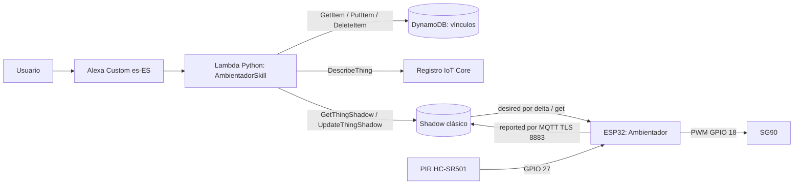
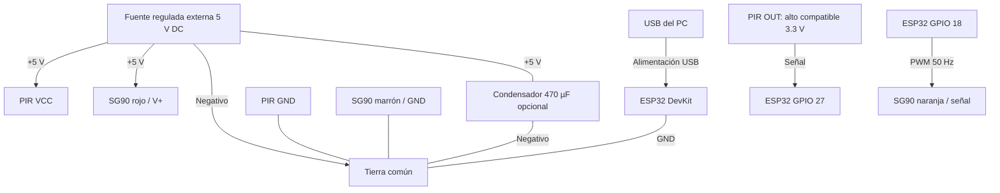
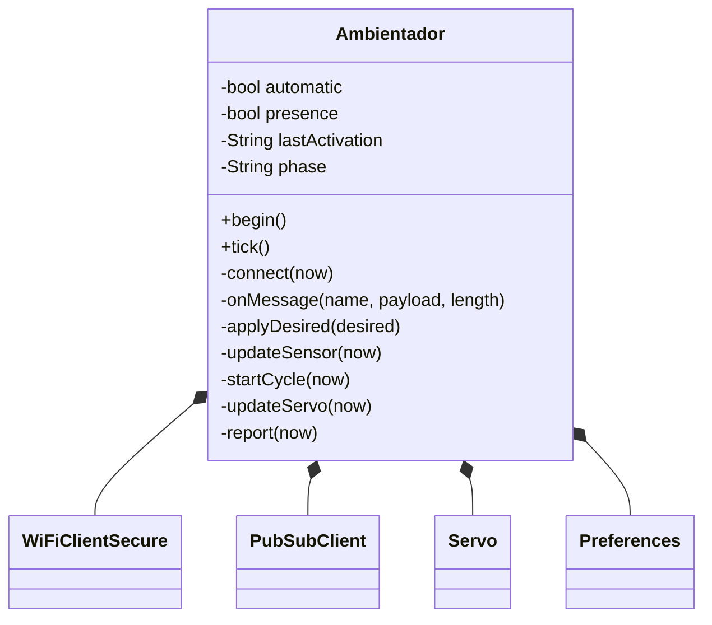
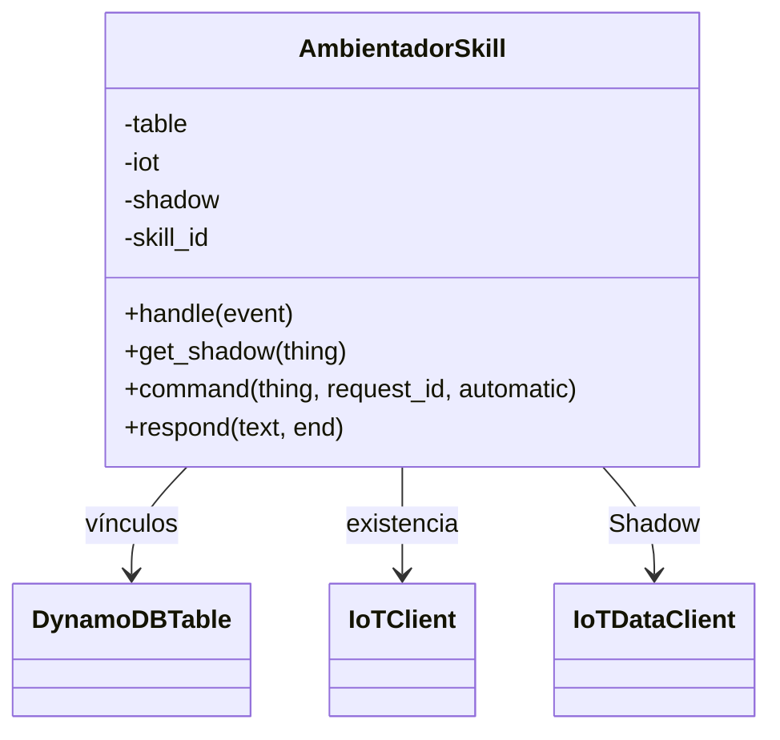
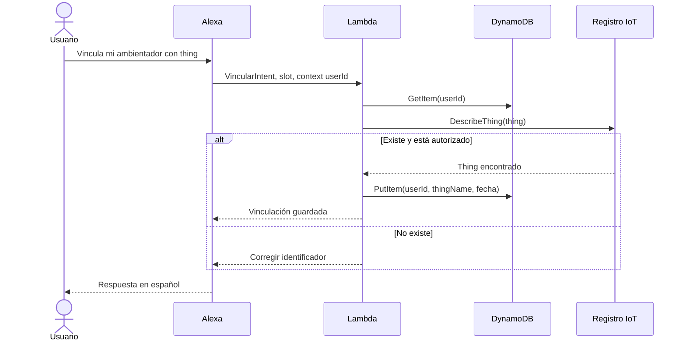
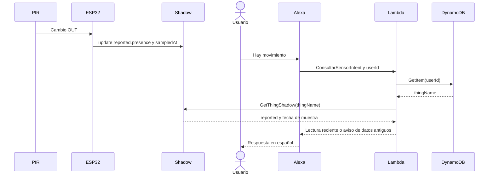
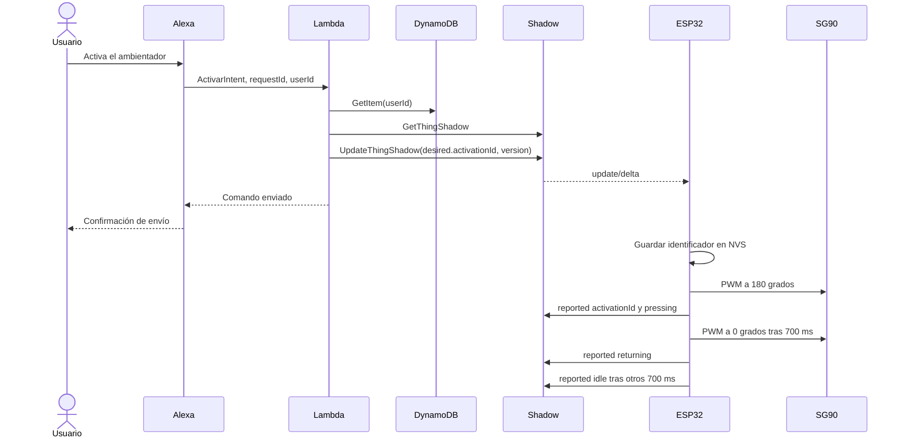
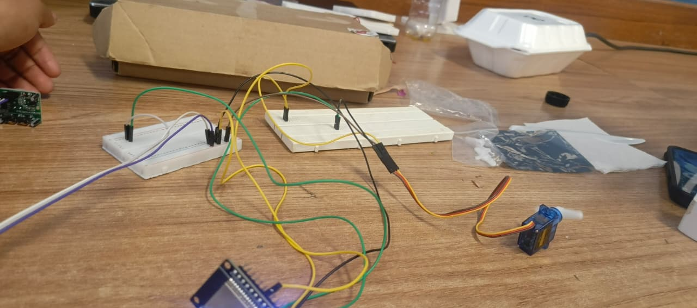
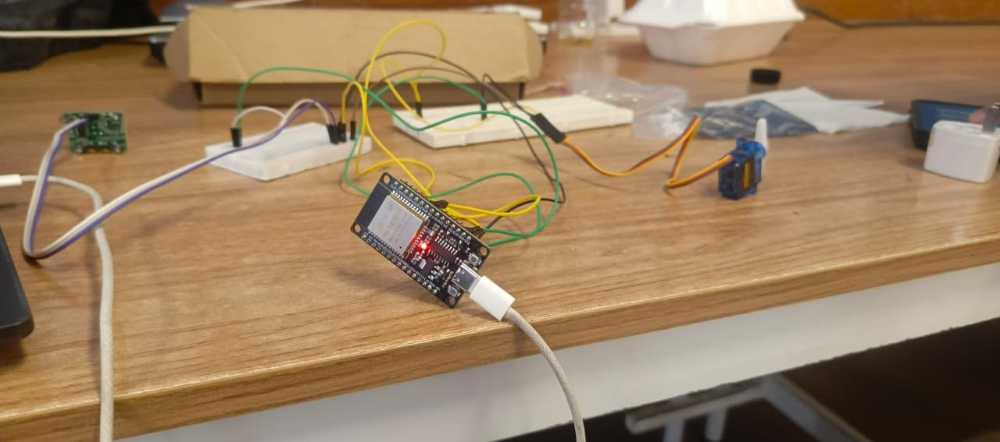

# Informe técnico — Ambientador inteligente

**Asignatura:** SIS-234. **Práctica:** 3. **Fecha de preparación:** 8 de noviembre de 2026.

**Revisión final:** 10 de noviembre de 2026.

Este documento describe la implementación desplegada del ambientador inteligente y los resultados obtenidos. Los resultados medidos y sus evidencias se detallan en la matriz de la sección 4 y en el [registro de evidencias](../evidencias/README.md).

## 1. Caso de uso y requerimientos

Se construye un ambientador que acciona un pulsador mediante un SG90 y detecta movimiento con un PIR HC-SR501. El usuario activa un ciclo desde Alexa y consulta sensor, motor y modo. La extensión automática activa un ciclo al detectar un nuevo flanco de movimiento una vez transcurrido el cooldown. Para las pruebas se configura un temporizador de 5 s; para el uso del ambientador en producción se propone 60 s para reducir dispensaciones y desperdicio de fragancia. Los 60 s son una decisión de diseño para producción y el ajuste de la prueba es de 5 s.

El PIR es apropiado para eventos de movimiento de personas en interiores. El SG90 realiza una acción mecánica de baja tensión con retorno al reposo. El firmware ordena posiciones y reporta la fase del ciclo, que se verifica con la observación del montaje y con los atributos `reported`.

El cooldown automático se mide con `millis()` sin bloquear el loop: se inicia al comenzar un ciclo y el siguiente ciclo automático solo puede empezar ante un nuevo flanco HIGH si ya transcurrieron 5000 ms, el servo está en reposo y el Shadow está sincronizado. Mantener HIGH no genera ciclos repetidos; después del cooldown se requiere un nuevo flanco. Los 5 s se usan en la configuración de pruebas para observar el comportamiento con agilidad. Para producción se propone 60 s para espaciar activaciones y reducir desperdicio de fragancia.

La extensión automática se habilita y deshabilita por voz, arranca desactivada y su valor se recupera desde `desired.automatic`; el firmware la ejecuta localmente ante un flanco del PIR, sin una nueva invocación de Lambda por movimiento.

### Trazabilidad funcional

| Requisito | Implementación y evidencia |
|---|---|
| RF1: capturar sensor | `Ambientador.updateSensor`, PIR digital; P01 |
| RF2: reportar sensor y actuador | `report`, cada cambio y cada 15 s; P02 |
| RF3: aplicar delta y confirmar | `onMessage`, `applyDesired`, `report`; pruebas de activación y reconexión |
| RF4: consulta sensor en español | `ConsultarSensorIntent`, reported; P04 |
| RF5: comando actuador por desired | `ActivarIntent`, `command`; activación documentada en AL01 |
| RF6: consulta actuador | `ConsultarMotorIntent`; P05 |
| RF7: vinculación persistente | `VincularIntent`, PutItem en DynamoDB; P06 |
| RF8: resolver usuario en cada solicitud | `context.System.user.userId`, GetItem consistente |
| RF9: validar/cambiar/eliminar vínculo | DescribeThing, PutItem, DeleteItem |
| Extensión: automático por voz y PIR | intents activar/desactivar, desired.automatic y flanco PIR |
| Sin LED como actuador, tensión ≤12 V DC | SG90 como actuador; LED integrado solo como indicador; tensión configurada según la práctica (fuente de 5 V); P16 |
| POO y legibilidad | una clase por ejecutable, métodos por responsabilidad; revisión de código |
| Ampliación futura | atributos nuevos del Shadow, nuevos intents y lecturas; conserva transporte y vinculación |

### Atributos no funcionales y criterios de aceptación

| Atributo | Criterio y condiciones | Resultado |
|---|---|---|
| Estabilidad | Sesión continua tras estabilización, cero reinicios/bloqueos, con ciclos completos | EP01: 15 min 42,995 s desde la primera muestra lista, sin reinicios, 11 ciclos completos |
| Detección PIR | Verificación funcional en el montaje: mano/objeto en el campo del sensor genera HIGH; al apuntar a una pared estática se observa LOW | Verificado en P01 (barrido 0–50 cm) y en N02 |
| Respuesta extremo a extremo | Máximo ≤3 s entre fin de frase y primer movimiento visible, con WiFi/IoT conectados | 15 mediciones realizadas en una sesión de 15 min (LT01) |
| Reporte por evento | ≤1 s desde cambio eléctrico OUT hasta recepción de update/accepted, conectado y sin reconexión TLS | Registro EP01 con confirmaciones de `reported` aceptadas |
| Respaldo periódico | Intervalo nominal de 15 s más margen de red de 1 s con conexión estable | Temporizador `REPORT_MS = 15000` en operación |
| Reconexión | Sincronizar y continuar el comando pendiente tras restablecer WiFi/Internet | R01: reconexión MQTT y solicitud de `desired` pendiente |
| Datos antiguos | Alexa no presenta como actuales muestras con más de 45 s o reloj inválido | Validación de `sampledAt` en cada consulta |
| Seguridad | TLS con validación de CA y certificado cliente; cero secretos versionados; ID de skill validado | `setCACert`, certificado de cliente y validación de `applicationId` |

La verificación PIR es funcional: el usuario identifica los HIGH de los logs con la mano de un estudiante frente al sensor y los LOW con el sensor dirigido a una pared para evitar detecciones espurias. La tabla de P01 registra el barrido cercano de 0–50 cm. El módulo permite ajustar manualmente el alcance máximo con sus potenciómetros, con un límite mínimo configurable de 300 cm, y un retardo de 5 a 7 s; estos valores corresponden al ajuste del módulo y se distinguen del cooldown de firmware. La tensión y el uso del LED integrado como simple indicador se registran según la configuración reportada y las fotografías.

## 2. Análisis y diseño

### Arquitectura

Todos los cambios de control de Alexa atraviesan el Shadow. El automático, una vez habilitado, se ejecuta en el ESP32.

### Circuito

El diagrama indica redes eléctricas: los nodos GPIO/GND pertenecen al mismo ESP32; VCC/OUT/GND al mismo PIR. No unir positivos de fuente externa y USB. Tabla de conexiones y precauciones concretas en [configuración](configuracion.md#2-conexiones). Las [fotografías del montaje](#evidencia-fotografica-del-montaje) se incluyen en anexos y documentan la placa y las conexiones.

### Clases del objeto inteligente

Una sola clase propia agrupa el estado y las operaciones del firmware. `setup` inicializa y `loop` llama a `tick`. El ciclo del servo usa estados y `millis`, de modo que no espera 700 ms con `delay`. La conexión TLS se inicia fuera del movimiento del servo.

### Clases de Lambda

El handler crea los clientes Boto3 una vez por contenedor y delega a la clase. Se inyectan los clientes en pruebas para verificar el contrato sin red. El despachador de intents es explícito y no usa un framework adicional.

### Secuencia: vincular o cambiar Thing

La vinculación se resuelve contra el registro IoT, incluso si el dispositivo está desconectado; el hardware no participa en este flujo.

### Secuencia: consultar sensor

La consulta lee la última muestra publicada por el dispositivo; Alexa no interroga al PIR en ese instante.

### Secuencia: activar el motor

La llegada del delta y la respuesta de voz pueden ocurrir en distinto orden. Alexa confirma la escritura del comando. El `activationId` reportado confirma la aceptación del comando por el controlador; `servoState=idle` posterior y la evidencia visual del ciclo permiten comprobar la ejecución.

### Contrato Shadow

Shadow clásico de `$aws/things/{thingName}/shadow`. Documento ilustrativo en [shadow.example.json](../infra/shadow.example.json); inicial real en [shadow-initial.json](../infra/shadow-initial.json).

| Atributo | Sección | Tipo y valores | Significado |
|---|---|---|---|
| `automatic` | desired / reported | boolean | Modo solicitado / modo aplicado |
| `activationId` | desired / reported | string 1–128 caracteres; reported inicial vacío | RequestId de la última activación solicitada / aceptada; repetirlo no repite el ciclo |
| `presence` | reported | boolean | Último nivel digital PIR; válido cuando pirReady=true |
| `pirReady` | reported | boolean | Transcurrieron 60 s desde arranque |
| `servoState` | reported | idle, pressing, returning | Fase del control PWM |
| `servoAngle` | reported | entero 0 o 180 por defecto | Ángulo ordenado según fase, calibrable |
| `cyclesSinceBoot` | reported | entero ≥0 | Ciclos completos desde último inicio, incluidos automáticos |
| `uptimeSeconds` | reported | entero ≥0 | Tiempo desde arranque; permite detectar reinicios |
| `sampledAt` | reported | entero epoch UTC segundos | Momento del reporte con reloj NTP |
| `version` | raíz, generado por AWS | entero creciente | Control de concurrencia y orden de mensajes |

`delta` lo genera AWS comparando desired con reported: no lo escribe Lambda ni la placa. El sensor y el ángulo no se escriben en desired. Lambda nunca falsifica reported: `reported` refleja lo que el controlador aplicó. Los campos nuevos pueden añadirse al contrato manteniendo los existentes.

Suscripciones QoS 1: `/get/accepted`, `/get/rejected`, `/update/delta`, `/update/accepted`, `/update/rejected`. Publicaciones QoS 0 mediante PubSubClient: `/get` y `/update`; los reportes periódicos reparan una publicación perdida.

Al reconectar se consulta `/get` antes de reportar/aplicar automático; se procesa todo desired, no solo futuros deltas. Un Shadow inexistente (404) se crea con el reporte inicial. Se ignoran documentos antiguos dentro de la sesión y los atributos mal tipados no disparan acciones.

### Activaciones, concurrencia y deduplicación

Un booleano `activar=true` no representa dos pulsaciones seguidas: después de converger no habría cambio. Por eso se usa un requestId distinto por comando. El mismo requestId se guarda en NVS antes de mover el servo, de modo que un reinicio no repite una activación ya aceptada.

Lambda admite una activación pendiente; si desired y reported difieren, pide esperar. `version` en UpdateThingShadow detecta escrituras concurrentes sobre un Shadow existente y se reintenta hasta tres veces. El Shadow se inicializa antes del uso, lo que habilita el bloqueo optimista desde la primera escritura.

Si el servo recibe un comando mientras está ocupado, el comando permanece en desired; al acabar, el firmware consulta el Shadow y lo aplica. Las activaciones automáticas requieren sincronización y MQTT conectado; se suspenden al perder conexión. Desactivar el modo automático deja finalizar el ciclo ya iniciado. El modo manual no usa el enfriamiento de 5 s y no superpone ciclos.

### Vinculación y modelo de datos

Tabla `AmbientadorVinculaciones`, clave única `userId` String; atributos `thingName` y `fechaVinculacion` (ISO 8601 UTC). Lectura consistente por solicitud, sin caché de vínculo entre sesiones. `DescribeThing` verifica existencia y la política IAM restringe el conjunto de Things autorizados.

El nombre se valida con `[A-Za-z0-9:_-]{1,128}`. El slot personalizado permite sinónimos hablados; se guarda el valor canónico. `PutItem` reemplaza el vínculo anterior y `DeleteItem` es idempotente. El nombre del Thing es un identificador y la autorización se apoya en la política IAM. Compartir un Thing entre usuarios está permitido en este prototipo.

### Skill

Invocación: **ambientador inteligente**. Idioma: **es-ES**. Modelo exportado en [interaction-model.es-ES.json](../alexa/interaction-model.es-ES.json).

| Intent | Slot | Ejemplo dentro de la sesión |
|---|---|---|
| VincularIntent | thingName: THING_NAME | vincula mi ambientador con thing |
| VincularIntent | thingName: THING_NAME | cambia mi ambientador a ambientador dos |
| DesvincularIntent | — | desvincula mi ambientador |
| ActivarIntent | — | activa el ambientador |
| ActivarAutomaticoIntent | — | activa el modo automático |
| DesactivarAutomaticoIntent | — | desactiva el modo automático |
| ConsultarSensorIntent | — | hay movimiento |
| ConsultarMotorIntent | — | cuál es el estado del motor |
| ConsultarAutomaticoIntent | — | está activado el modo automático |
| AMAZON.HelpIntent / FallbackIntent | — | ayuda / frase no reconocida |
| AMAZON.StopIntent / CancelIntent | — | salir / cancelar |

Las frases se probaron dentro de la sesión abierta con la invocación de la skill, según el comportamiento de una skill Custom.

### Justificación de reportes y consumo

Un PIR genera eventos discretos: se reportan cambios HIGH/LOW con objetivo ≤1 s. El respaldo de 15 s permite detectar datos antiguos (umbral 45 s) y recuperar reportes QoS 0 perdidos. La condición de 200 ms evita saturar el broker por cambios rápidos.

Con estado quieto: 4 publicaciones/min, 240/hora, 5760/día, 172800 en 30 días por dispositivo. Es el número de publicaciones de la aplicación; el total facturable suma mensajes de respuesta, operaciones Shadow, consultas y comandos. Para sesiones de laboratorio de 15 min son aproximadamente 60 reportes periódicos más eventos. En una versión comercial se puede aumentar el intervalo de respaldo, conservando el reporte por evento.

## 3. Desarrollo e implementación

Fuentes: [main.cpp](../firmware/src/main.cpp) contiene `setup` y `loop`; [Ambientador.h](../firmware/include/Ambientador.h) declara la clase y [Ambientador.cpp](../firmware/src/Ambientador.cpp) implementa conexión, sensor, servo y reportes. Las constantes de este último concentran pines y tiempos. [lambda_function.py](../backend/lambda_function.py) implementa el backend y [test_backend.py](../tests/test_backend.py) sus pruebas. Las dependencias están fijadas en [platformio.ini](../firmware/platformio.ini).

El código enciende el LED integrado de la placa durante el ciclo como indicador auxiliar; el actuador mecánico es el SG90. La alimentación del montaje se configuró a 5 V, dentro del límite de tensión de la práctica.

Los fragmentos clave son `applyDesired` (validación, deduplicación y persistencia), `updateServo` (máquina de estados sin espera larga), `command` (escritura desired versionada) y `handle` (usuario, vinculación e intents). Se enlaza el código para evitar duplicarlo entero en el informe.

Configuración AWS y Alexa paso a paso en [configuracion.md](configuracion.md). Exportaciones: [tabla](../infra/dynamodb-table.json), [política IoT](../infra/iot-policy.template.json), [rol Lambda](../infra/lambda-role-policy.template.json), [trust policy](../infra/lambda-trust-policy.json), [variables](../backend/environment.example.json), [secretos de ejemplo](../firmware/include/secrets.example.h).

Las plantillas limitan `iot:Connect` al cliente `thing`, `iot:Publish` a Shadow get/update y `iot:Subscribe/Receive` a sus respuestas y delta. Lambda requiere `iot:DescribeThing`, `iot:GetThingShadow` e `iot:UpdateThingShadow` sobre `thing` y `ambientador-dos`; `dynamodb:GetItem/PutItem/DeleteItem` sobre la tabla de vínculos y permisos de escritura de logs. Así se separa el acceso del dispositivo del backend. `logs:CreateLogGroup` conserva un comodín dentro de la cuenta/región; en producción puede retirarse si el grupo está precreado. La skill se ejecuta con permisos acotados a esos recursos.

La infraestructura está desplegada en AWS: Thing y Shadow clásico en IoT Core, tabla `AmbientadorVinculaciones`, política IoT asociada al certificado, rol de ejecución de Lambda y función `Alexa` con su disparador Alexa Skills Kit. La vinculación Lambda–DynamoDB está verificada sobre esa infraestructura, y el modelo de interacción se importó y construyó en la skill es-ES.

Las credenciales WiFi, certificados y clave están excluidos con `.gitignore`. La Lambda utiliza su rol y el firmware certificados; no hay access keys incorporadas.

## 4. Pruebas y validaciones

El [plan y los procedimientos](pruebas.md) definen los casos. La [carpeta de evidencias](../evidencias/README.md) reúne capturas del simulador, registros locales, fotos y logs. Las capturas recibidas acreditan los comandos que muestran; la [carpeta de grabaciones en vivo](https://drive.google.com/drive/folders/1d_Hg945M0cD-lJ1bk0L4BZTwfwMi8PAt?usp=sharing) queda como evidencia complementaria.

| Prueba | Resultado | Evidencia y alcance |
|---|---|---|
| Pruebas unitarias del backend (22) | ✅ Completada | [Verificación local](../evidencias/verificacion-local.txt): 22/22 satisfactorias con clientes AWS simulados. |
| Compilación del firmware | ✅ Completada | [Verificación local](../evidencias/verificacion-local.txt): PlatformIO terminó correctamente para `esp32doit-devkit-v1`. |
| Comandos de Alexa capturados en vivo | ✅ Completada | [AL01](../evidencias/pruebas-alexa-vivo.md) contiene capturas de apertura, activación del motor, consultas de sensor y motor y control/consulta del modo automático, junto con la confirmación de la prueba de vinculación. |
| P01 — Lectura PIR / RF1 | ✅ Completada | [Barrido 0–50 cm](../evidencias/pir-rango-0-50cm.md): detección HIGH reportada cada 5 cm en las 11 posiciones, desde 0 hasta 50 cm. |
| P02 — Reporte de sensor/actuador / RF2 | ✅ Completada | EP01 registra confirmaciones de `reported` aceptadas por AWS durante la operación del dispositivo. |
| P04–P05 — Consultas de sensor y motor / RF4, RF6 | ✅ Completada | AL01 captura sensor con movimiento y sin movimiento, y la consulta del motor en reposo. |
| P06 — Vinculación / RF7 | ✅ Completada | Comando de vinculación ejecutado con Thing; persistencia en DynamoDB verificada en la infraestructura desplegada. |
| P11 — Modo automático y cooldown | ✅ Completada | El video de [Google Drive](https://drive.google.com/drive/folders/1d_Hg945M0cD-lJ1bk0L4BZTwfwMi8PAt?usp=sharing) valida físicamente el temporizador de 5 s. El firmware usa `AUTO_COOLDOWN_MS = 5000`; para producción se propone 60 s para reducir desperdicio. |
| P13 — Reconexión | ✅ Completada | [R01](../evidencias/reconexion-mqtt.md): reconexión MQTT, solicitud de `desired` pendiente y dos `reported` aceptados. |
| P16 — Restricciones del montaje | ✅ Completada | Tensión configurada según la práctica; el SG90 es el actuador mecánico y el LED integrado solo indica estado. Las [fotos del montaje](#evidencia-fotografica-del-montaje) documentan la placa y conexiones. |
| P18 — Frases de modo automático | ✅ Completada | Los comandos para activar, desactivar y consultar el modo automático se validaron en las pruebas en vivo. |
| N02 — Respuesta funcional PIR | ✅ Completada | [Logs y tabla de contexto](../evidencias/pir-rango-0-50cm.md): HIGH al colocar la mano frente al sensor y LOW al apuntarlo a una pared estática. |
| LT01 — Ejecución de mediciones de latencia | ✅ Completada | 15 mediciones de respuesta realizadas con el ESP32 funcionando durante una sesión de 15 min. |
| N04 — Reportes a la nube | ✅ Completada | Los logs incluyen actualizaciones `reported` aceptadas durante la operación y tras reconectar el ESP32. |
| N05 — Reconexión | ✅ Completada | Desconexión y reconexión del ESP32 confirmadas; R01 registra MQTT conectado nuevamente y `reported` aceptado. |

### Detalle del barrido P01

Se probó el PIR desde 0 hasta 50 cm, avanzando 5 cm en cada ensayo. En todas las posiciones reportadas se detectó el objeto y la salida se puso en HIGH. Según el usuario, el módulo permite ajustar manualmente con sus potenciómetros el alcance máximo, cuyo límite mínimo configurable es 300 cm, y un retardo entre 5 y 7 s. P01 registra el barrido realizado de 0–50 cm.

| Distancia | Salida PIR | Resultado |
|---:|:---:|---|
| 0 cm | HIGH | ✅ Detectado |
| 5 cm | HIGH | ✅ Detectado |
| 10 cm | HIGH | ✅ Detectado |
| 15 cm | HIGH | ✅ Detectado |
| 20 cm | HIGH | ✅ Detectado |
| 25 cm | HIGH | ✅ Detectado |
| 30 cm | HIGH | ✅ Detectado |
| 35 cm | HIGH | ✅ Detectado |
| 40 cm | HIGH | ✅ Detectado |
| 45 cm | HIGH | ✅ Detectado |
| 50 cm | HIGH | ✅ Detectado |

✅ indica que se verificó la función descrita con la evidencia correspondiente. Los detalles están en [AL01](../evidencias/pruebas-alexa-vivo.md), el [barrido PIR](../evidencias/pir-rango-0-50cm.md) y el [análisis EP01](../evidencias/ejecucion-prolongada.md), junto con sus CSV.

## 5. Resultados

| Resultado | Medición / estado |
|---|---|
| Backend Python | 22/22 pruebas locales satisfactorias el 2026-11-08 |
| Firmware ESP32 | Compilación correcta, placa confirmada esp32doit-devkit-v1 con espressif32 6.9.0 |
| RAM estática estimada por compilador | 46 556 / 327 680 bytes (14,2 %) |
| Flash | 929 425 / 1 310 720 bytes (70,9 %) con placa confirmada |
| AWS | Infraestructura desplegada en `us-east-2`: Thing, Shadow clásico, tabla `AmbientadorVinculaciones`, política IoT, rol y función Lambda `Alexa` con disparador Alexa Skills Kit |
| Alexa Developer Console | Capturas AL01: apertura, activación, consultas del sensor/motor y control/consulta del modo; vinculación probada con Thing |
| MQTT / Shadow | EP01 y R01: conexión, reconexión y `reported` aceptado; AL01 incluye un ciclo de servo registrado |
| PIR y estabilidad | Respuesta funcional PIR verificada en el barrido 0–50 cm; ventana de 15 min 42,995 s sin reinicios y 11 ciclos completos en EP01 |
| Latencia | 15 mediciones de respuesta realizadas durante una sesión de 15 min con el ESP32 en funcionamiento |
| Reconexión MQTT | Verificada: R01 registra MQTT reconectado y `reported` aceptado, con solicitud de `desired` pendiente |
| Dosificación | El SG90 ejecuta el ciclo de presión y retorno; la dosis se define con la calibración del mecanismo acoplado |

EP01 contiene 11 ciclos completos. La ventana desde la primera muestra lista es de 942 995 ms (15 min 42,995 s). Además, se realizó otra sesión de 15 min con el ESP32 encendido y funcionando, en la que se hicieron las 15 mediciones de respuesta. Los 22 tests verifican el contrato del backend con clientes AWS simulados y cubren las ramas de vinculación, comandos, consultas y validaciones.

Las 15 mediciones de respuesta se ejecutaron durante la sesión de 15 min con el dispositivo en funcionamiento. EP01 corresponde a la prueba con cooldown de 60 s; el video más reciente confirma el comportamiento físico del cooldown de 5 s usado para pruebas. Para producción se propone volver a 60 s con el fin práctico de reducir desperdicio de fragancia.

## 6. Conclusiones

1. **Integración y separación de responsabilidades.** El diseño y el código implementan el recorrido Alexa → Lambda → Shadow → ESP32, con consultas sobre reported y comandos sobre desired. AL01 documenta comandos del simulador y un ciclo de servo registrado, y la vinculación se probó sobre la infraestructura desplegada. Los RF1–RF9 cuentan con implementación y evidencia asociada.

2. **Vinculación persistente y extensibilidad.** El comando de vinculación se ejecutó con un Thing y la persistencia en DynamoDB se verificó en el despliegue. El contrato Shadow y la separación de módulos permiten incorporar sensores, atributos e intents conservando el transporte y la vinculación.

3. **Estabilidad observada.** EP01 registra más de 15 min desde la primera muestra lista, sin reinicios visibles, con 11 ciclos completos. Una sesión adicional de 15 min con el ESP32 en funcionamiento aportó las 15 mediciones de respuesta. El firmware mantiene el loop no bloqueante y la reconexión automática durante toda la sesión.

4. **Medición y respuesta.** Se realizaron 15 mediciones de respuesta en una sesión de 15 min con el dispositivo operativo. La detección PIR se comprobó funcionalmente en el rango cercano y frente a una pared estática. Los reportes `reported` fueron aceptados por AWS de forma repetida, incluso tras reconectar el dispositivo. La reconexión funcional se observó con recuperación de la sesión MQTT.

5. **Alcance del accionamiento.** El PIR informa movimiento y el SG90 recibe una orden de posición. El sistema implementa el accionamiento y la consulta remota; el acoplamiento del mecanismo permite calibrar el recorrido y la dosis del ambientador.

6. **Comportamiento observado del PIR y temporizador.** El video demuestra físicamente el cooldown automático de 5 s usado en las pruebas. El temporizador no bloquea el firmware y requiere un nuevo flanco PIR después de transcurridos los 5 s, sin repetir ciclos por mantener HIGH. Para producción se propone configurar 60 s para espaciar dispensaciones y reducir el desperdicio de fragancia. El barrido de 0–50 cm y la respuesta HIGH ante la mano/LOW frente a pared documentan el comportamiento funcional en las condiciones probadas.

7. **Cumplimiento de la entrega.** La documentación cubre los diagramas, el contrato, la vinculación y el modelo de interacción exigidos, y la infraestructura se encuentra desplegada y operativa con las pruebas registradas en la sección 4.

## 7. Recomendaciones

Calibrar recorrido y alimentación del mecanismo acoplado. Para evolucionar, incorporar realimentación mecánica, nivel de consumible y límite de dosificación; añadir atributos e intents sin cambiar la vinculación ni el transporte. Para usuarios externos, implementar prueba de propiedad y evitar vinculación por nombre público. Si se necesitan varias órdenes pendientes, usar una cola de comandos con confirmaciones en una versión posterior: el Shadow no es una cola.

Ajustar la frecuencia de reporte según costo y fiabilidad observados, medir consumo de heap durante TLS y diseñar recuperación específica ante cortes de energía.

## 8. Anexos

- [Guía de defensa](defensa.md) y [registro de evidencias](../evidencias/README.md).
- La matriz de pruebas se detalla en la sección 4 y en el [plan de pruebas](pruebas.md).
- [Consigna original](../Práctica_3.md).
- Las fotografías disponibles se insertan abajo. Los videos en vivo están en la [carpeta compartida de Google Drive](https://drive.google.com/drive/folders/1d_Hg945M0cD-lJ1bk0L4BZTwfwMi8PAt?usp=sharing).
- Región, cuenta, Thing, endpoint ATS, ID de skill, placa y Lambda `Alexa`: registrados en [configuración](configuracion.md).
- Entrega: repositorio accesible en GitHub, enlace por LMS-UCB, martes 10 de noviembre de 2026 a las 17:45; aportes mediante commits propios de cada integrante.

### Evidencia fotográfica del montaje

Las imágenes documentan el montaje físico compartido.

**Montaje 1 — ESP32, conexiones y servo**

**Montaje 2 — ESP32 alimentado y servo**

### Referencias técnicas

- [AWS: documento Shadow y delta](https://docs.aws.amazon.com/iot/latest/developerguide/device-shadow-document.html).
- [AWS: sincronización y bloqueo optimista](https://docs.aws.amazon.com/iot/latest/developerguide/device-shadow-data-flow.html).
- [PubSubClient: API y buffer MQTT](https://pubsubclient.knolleary.net/api).
- [ESP32Servo: biblioteca](https://github.com/madhephaestus/ESP32Servo).
- [Alexa: invocación de skills Custom](https://developer.amazon.com/en-US/docs/alexa/custom-skills/understanding-how-users-invoke-custom-skills.html).
- [Adafruit: comportamiento y estabilización de PIR](https://learn.adafruit.com/pir-passive-infrared-proximity-motion-sensor?view=all).

### Evidencia de ejecución prolongada EP01 (incorporada 2026-11-09)

El registro serie abarca 16 min 50,079 s desde arranque: 11 ciclos completos. Desde la primera muestra lista hasta la última hay 15 min 42,995 s sin reinicios. El registro conserva los tiempos del controlador, los mensajes del ciclo del servo y las confirmaciones de `reported` aceptado por AWS.

Siete HIGH listos coinciden con inicio de ciclo; otro HIGH a 431618 ms no activa, solo 14,727 s después del ciclo anterior, coherente con el cooldown de 60 s de esa ejecución. Hay conexión MQTT y confirmaciones repetidas de `reported` aceptado. El usuario identifica los HIGH de los logs con la mano frente al sensor y los LOW con el sensor dirigido a una pared estática; junto con el barrido de 0–50 cm, esto documenta la respuesta funcional del PIR.

El video más reciente confirma el comportamiento físico del cooldown de prueba de 5 s; para producción se propone 60 s a fin de evitar desperdicio. Ver [análisis, cobertura y resultados](../evidencias/ejecucion-prolongada.md), [capturas Alexa](../evidencias/pruebas-alexa-vivo.md) y el [registro PIR](../evidencias/pir-rango-0-50cm.md).
