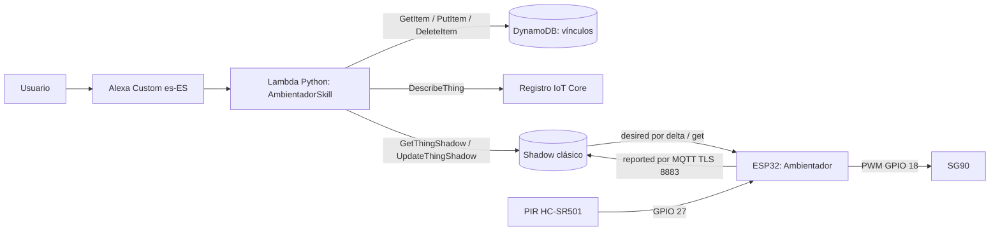
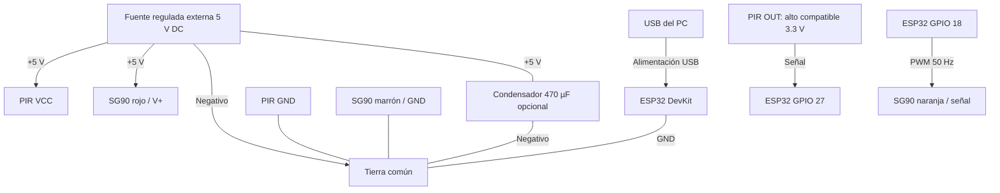
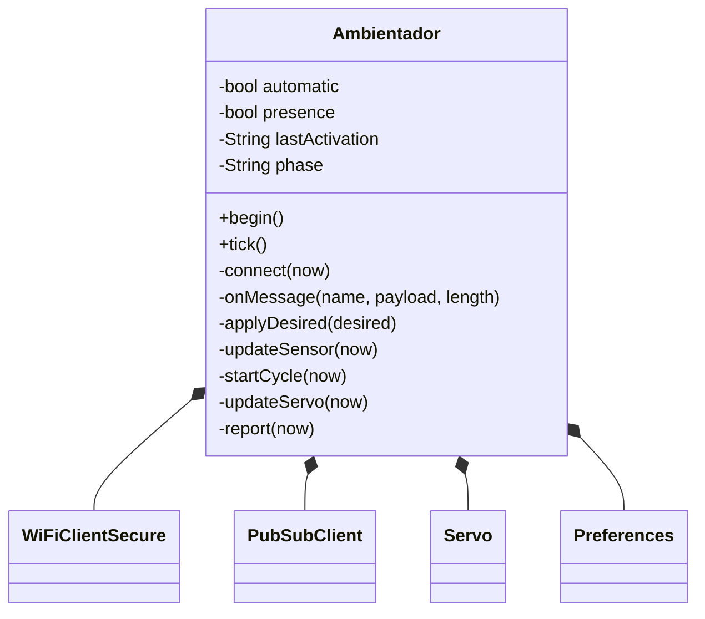
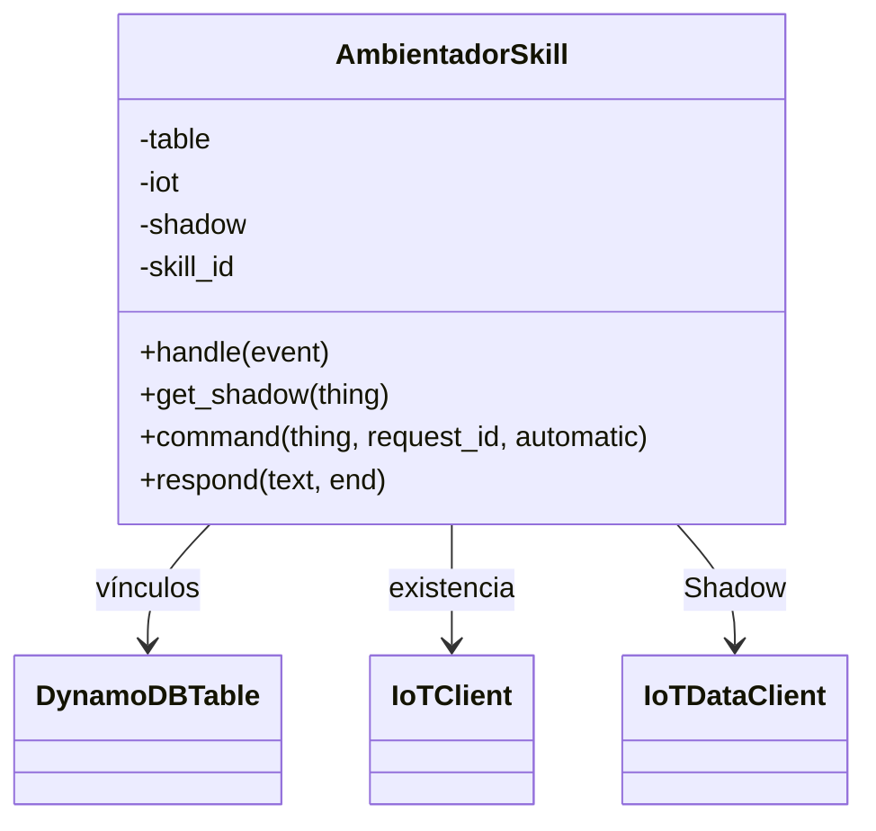
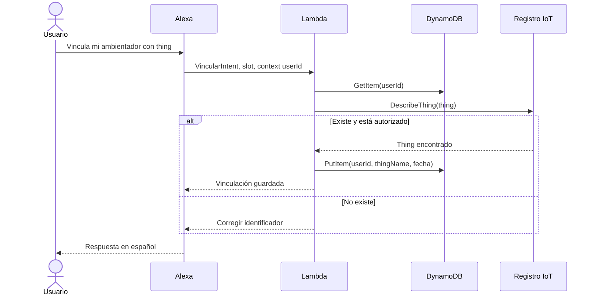
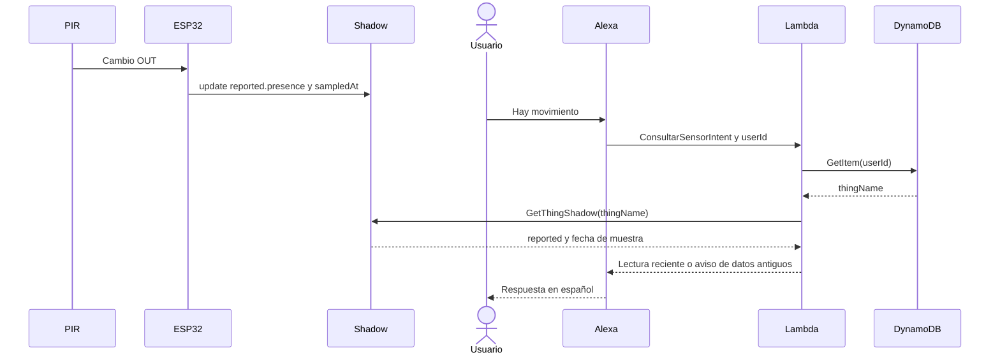
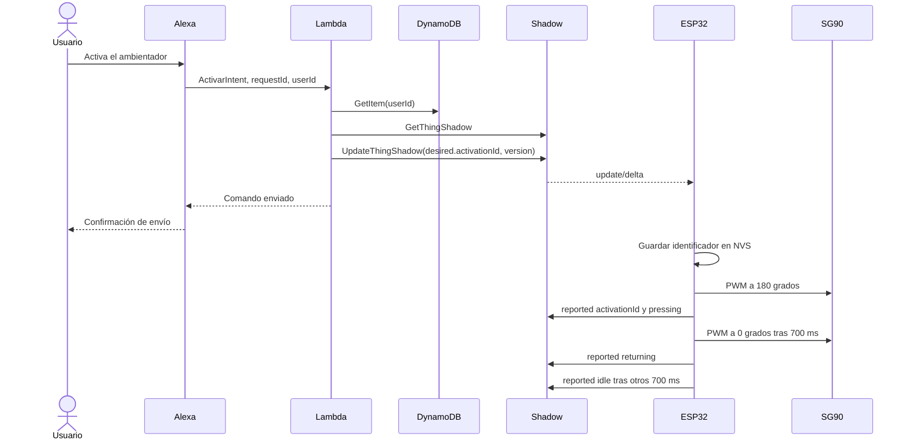

# Base del informe técnico — Ambientador inteligente

**Asignatura:** SIS-234. **Práctica:** 3. **Fecha de preparación:** 8 de noviembre de 2026.

**Integrantes y aportes:** pendiente de completar con nombres y commits reales.

Este documento describe la implementación existente. Los resultados de nube y hardware aún no medidos están identificados como pendientes. Debe completarse con las evidencias del [plan de pruebas](pruebas.md) antes de entregar.

## 1. Caso de uso y requerimientos

Se construye la base de un ambientador que puede accionar un pulsador mediante un SG90 y detectar movimiento con un PIR HC-SR501. El usuario puede activar un ciclo desde Alexa y consultar sensor, motor y modo. La extensión automática permite activar al detectar un nuevo movimiento, con una separación mínima de 5 s (configuración de pruebas), para evitar dispensaciones continuas mientras la salida PIR permanece alta.

El PIR es apropiado para eventos de movimiento de personas en interiores; no mide distancia ni confirma ocupación inmóvil. El SG90 permite una acción mecánica de baja tensión con retorno al reposo. El prototipo no mide dosis, presión aplicada, cantidad de perfume ni posición física del eje. Primero se demuestra el movimiento sin acoplar un aerosol real; una aplicación final requiere calibración mecánica y validación del dispensador.

**Diferencia respecto a la consigna:** el texto de la práctica limita el actuador al control por voz, mientras el solicitante requiere modo automático. Se implementa como extensión separada, desactivada por defecto y habilitada mediante desired por Alexa. Su aceptación por el docente queda por confirmar; no se presenta como una exigencia original.

### Trazabilidad funcional

| Requisito | Implementación y evidencia prevista |
|---|---|
| RF1: capturar sensor | `Ambientador.updateSensor`, PIR digital; P01 |
| RF2: reportar sensor y actuador | `report`, cada cambio y cada 15 s; P02 |
| RF3: aplicar delta y confirmar | `onMessage`, `applyDesired`, `report`; P03, P13 |
| RF4: consulta sensor en español | `ConsultarSensorIntent`, reported; P04 |
| RF5: comando actuador por desired | `ActivarIntent`, `command`; P03 |
| RF6: consulta actuador | `ConsultarMotorIntent`; P05 |
| RF7: vinculación persistente | `VincularIntent`, PutItem en DynamoDB; P06 |
| RF8: resolver usuario en cada solicitud | `context.System.user.userId`, GetItem consistente; P07 |
| RF9: validar/cambiar/eliminar vínculo | DescribeThing, PutItem, DeleteItem; P08–P10 |
| Extensión: automático por voz y PIR | intents activar/desactivar, desired.automatic y flanco PIR; P11 |
| Sin LEDs como actuador, tensión ≤12 V DC | SG90 con fuente de 5 V; P16 |
| POO y legibilidad | una clase por ejecutable, métodos por responsabilidad; revisión de código |
| Ampliación futura | atributos nuevos del Shadow, nuevos intents y lecturas; conserva transporte y vinculación |

### Atributos no funcionales declarados

Son **criterios de aceptación por medir**, no garantías de rendimiento ya demostradas.

| Atributo | Criterio y condiciones |
|---|---|
| Estabilidad | 15 min continuos tras estabilización, cero reinicios/bloqueos, con al menos 10 ciclos |
| Exactitud PIR | Error de clasificación ≤10 % en 40 ensayos: 20 con movimiento humano transversal a 1–3 m y 20 sin movimiento, interior sin sol directo ni fuentes calientes móviles |
| Respuesta extremo a extremo | Máximo ≤3 s entre fin de frase y primer movimiento visible, en 20 comandos con WiFi/IoT conectados; registrar arranque frío de Lambda |
| Reporte por evento | ≤1 s desde cambio eléctrico OUT hasta recepción de update/accepted, conectado y sin reconexión TLS |
| Respaldo periódico | Intervalo máximo observado ≤16 s entre reportes aceptados con conexión estable; temporizador nominal 15 s más margen de red de 1 s |
| Reconexión | Objetivo ≤30 s desde restablecimiento de WiFi/Internet hasta sincronizar y comenzar el comando pendiente, en 3 ensayos |
| Datos antiguos | Alexa no presenta como actuales muestras con más de 45 s o reloj inválido |
| Seguridad | TLS con validación de CA y certificado cliente; cero secretos versionados; ID de skill validado |

La exactitud binaria se evalúa con `(FP + FN) / 40 × 100`; no corresponde expresar un error en centímetros. Se usa una referencia física observable en vídeo y se registran TP, TN, FP y FN. La baja tensión, el cableado y la ausencia de credenciales son verificaciones documentales/físicas adicionales.

## 2. Análisis y diseño

### Arquitectura

No hay HTTP directo a la placa ni publicaciones de comandos MQTT desde Lambda. Todos los cambios de control de Alexa atraviesan el Shadow. El automático, una vez habilitado, se ejecuta en el ESP32; no se requiere una nueva invocación Lambda por movimiento.

### Circuito

El diagrama indica redes eléctricas: los nodos GPIO/GND pertenecen al mismo ESP32; VCC/OUT/GND al mismo PIR. No unir positivos de fuente externa y USB. Tabla de conexiones y precauciones concretas en [configuración](configuracion.md#2-conexiones). Adjuntar fotografía del montaje y ficha del módulo exacto en anexos.

### Clases del objeto inteligente

Una sola clase propia evita dividir artificialmente un firmware pequeño. `setup` inicializa y `loop` llama a `tick`. El ciclo del servo usa estados y `millis`, de modo que no espera 700 ms con `delay`. La conexión TLS puede bloquear unos segundos; se evita iniciarla durante el movimiento.

### Clases de Lambda

El handler crea los clientes Boto3 una vez por contenedor y delega a la clase. Se inyectan los clientes en pruebas para verificar el contrato sin red. No se usa un framework adicional de intents: el despachador pequeño es explícito.

### Secuencia: vincular o cambiar Thing

La placa no participa en la vinculación: se valida el registro IoT, incluso si el dispositivo está desconectado. No se inventa una comunicación al hardware para este flujo.

### Secuencia: consultar sensor

La consulta lee la última muestra; no exige que Alexa interrogue al PIR en ese instante.

### Secuencia: activar el motor

La llegada del delta y la respuesta de voz pueden ocurrir en distinto orden. Alexa confirma la escritura, no una ejecución física comprobada. El `activationId` reportado confirma aceptación del comando por el controlador; `servoState=idle` posterior y evidencia visual permiten comprobar el ciclo.

### Contrato Shadow

Shadow clásico de `$aws/things/{thingName}/shadow`. Documento ilustrativo en [shadow.example.json](../infra/shadow.example.json); inicial real en [shadow-initial.json](../infra/shadow-initial.json).

| Atributo | Sección | Tipo y valores | Significado |
|---|---|---|---|
| `automatic` | desired / reported | boolean | Modo solicitado / modo aplicado |
| `activationId` | desired / reported | string 1–128 caracteres; reported inicial vacío | RequestId de la última activación solicitada / aceptada; repetirlo no debe repetir el ciclo |
| `presence` | reported | boolean | Último nivel digital PIR; válido cuando pirReady=true |
| `pirReady` | reported | boolean | Transcurrieron 60 s desde arranque |
| `servoState` | reported | idle, pressing, returning | Fase del control PWM, no sensor de posición |
| `servoAngle` | reported | entero 0 o 180 por defecto | Ángulo ordenado según fase, calibrable |
| `cyclesSinceBoot` | reported | entero ≥0 | Ciclos completos desde último inicio, incluidos automáticos |
| `uptimeSeconds` | reported | entero ≥0 | Tiempo desde arranque; útil para detectar reinicios |
| `sampledAt` | reported | entero epoch UTC segundos | Momento del reporte con reloj NTP |
| `version` | raíz, generado por AWS | entero creciente | Control de concurrencia y orden de mensajes |

`delta` lo genera AWS comparando desired con reported: no lo escribe Lambda ni la placa. El sensor y el ángulo no se escriben en desired. Lambda nunca falsifica reported. Los campos nuevos pueden añadirse al contrato manteniendo los existentes.

Suscripciones QoS 1: `/get/accepted`, `/get/rejected`, `/update/delta`, `/update/accepted`, `/update/rejected`. Publicaciones QoS 0 mediante PubSubClient: `/get` y `/update`; los reportes periódicos reparan una publicación perdida. No se promete entrega exactly-once. El buffer MQTT tiene 8192 bytes y el contrato debe mantenerse pequeño.

Al reconectar se consulta `/get` antes de reportar/aplicar automático; se procesa todo desired, no solo futuros deltas. Un Shadow inexistente (404) se crea con el reporte inicial. Se ignoran documentos antiguos dentro de la sesión y los atributos mal tipados no disparan acciones.

### Activaciones, concurrencia y fallos

Usar un booleano `activar=true` no representa correctamente dos pulsaciones seguidas: después de converger no habría cambio. Por eso se usa un requestId distinto por comando. El mismo requestId se guarda en NVS antes de mover el servo para evitar repetir una activación tras reiniciar.

Existe una ventana entre persistir y mover: un corte de energía allí puede omitir un ciclo. Se prefiere evitar una dosis duplicada, pero no se garantiza una transacción atómica entre flash y mecánica. Solo se recuerda el último comando, no un historial de deduplicación ilimitado. Borrar NVS puede volver a ejecutar un desired antiguo.

Lambda admite una activación pendiente; si desired y reported difieren, pide esperar. No hay cola. `version` en UpdateThingShadow detecta escrituras concurrentes sobre un Shadow existente y se reintenta hasta tres veces. Conviene inicializar el Shadow antes del uso: crear un Shadow inexistente no tiene una versión previa para bloqueo optimista, por lo que no se garantiza exclusión de dos primeras creaciones simultáneas.

Si el servo recibe un comando mientras está ocupado, permanece pendiente en desired; al acabar consulta el Shadow. Las activaciones automáticas requieren sincronización y MQTT conectado; se suspenden al perder conexión. Desactivar modo automático deja finalizar el ciclo ya iniciado. El modo manual no usa el enfriamiento de 5 s, pero impide superponer ciclos.

### Vinculación y modelo de datos

Tabla `AmbientadorVinculaciones`, clave única `userId` String; atributos `thingName` y `fechaVinculacion` (ISO 8601 UTC). Lectura consistente por solicitud, sin caché de vínculo entre sesiones. `DescribeThing` verifica existencia y la política IAM restringe el conjunto de Things autorizados.

El nombre se valida con `[A-Za-z0-9:_-]{1,128}`. El slot personalizado permite sinónimos hablados; se guarda el valor canónico. `PutItem` reemplaza el vínculo anterior y `DeleteItem` es idempotente. El nombre del Thing es un identificador, no un secreto ni prueba de propiedad. Compartir un Thing entre usuarios está permitido en este prototipo; no se implementa OAuth.

### Skill

Invocación: **ambientador inteligente**. Idioma: **es-ES**. Modelo exportado en [interaction-model.es-ES.json](../alexa/interaction-model.es-ES.json).

| Intent | Slot | Ejemplo dentro de la sesión |
|---|---|---|
| VincularIntent | thingName: THING_NAME | vincula mi ambientador con thing |
| VincularIntent | thingName: THING_NAME | cambia mi ambientador a ambientador dos |
| DesvincularIntent | — | desvincula mi ambientador |
| ActivarIntent | — | activa el ambientador |
| ActivarAutomaticoIntent | — | activa el modo automático |
| DesactivarAutomaticoIntent | — | desactiva el modo automático |
| ConsultarSensorIntent | — | hay movimiento |
| ConsultarMotorIntent | — | cuál es el estado del motor |
| ConsultarAutomaticoIntent | — | está activado el modo automático |
| AMAZON.HelpIntent / FallbackIntent | — | ayuda / frase no reconocida |
| AMAZON.StopIntent / CancelIntent | — | salir / cancelar |

Una skill Custom necesita abrir sesión o incluir su invocación; no se garantiza capturar globalmente «Alexa, activa el ambientador». Esto debe demostrarse con el simulador usando las frases compatibles.

### Justificación de reportes y consumo

Un PIR genera eventos discretos: se reportan cambios HIGH/LOW con objetivo ≤1 s. El respaldo de 15 s permite detectar datos antiguos (umbral 45 s) y recuperar reportes QoS 0 perdidos. La condición de 200 ms evita saturar el broker por cambios rápidos.

Con estado quieto: 4 publicaciones/min, 240/hora, 5760/día, 172800 en 30 días por dispositivo. Es el número de publicaciones de la aplicación, **no el total facturable**: deben sumarse mensajes de respuesta, operaciones Shadow, consultas y comandos. Para sesiones de laboratorio de 15 min son aproximadamente 60 reportes periódicos más eventos. No se afirma cobertura gratuita; verificar condiciones de la cuenta y configurar alerta de facturación. En una versión comercial se puede aumentar el intervalo de respaldo, conservando reporte por evento.

## 3. Desarrollo e implementación

Fuentes: [main.cpp](../firmware/src/main.cpp), [lambda_function.py](../backend/lambda_function.py), [tests](../tests/test_backend.py). Las constantes del firmware concentran pines y tiempos. Las dependencias PlatformIO están fijadas para reproducibilidad con Arduino ESP32 2.x; no se actualiza ESP32Servo a una versión incompatible sin recompilar.

Los fragmentos clave son `applyDesired` (validación, deduplicación y persistencia), `updateServo` (máquina de estados sin espera larga), `command` (escritura desired versionada) y `handle` (usuario, vinculación e intents). Se enlaza el código para evitar duplicarlo entero en el informe.

Configuración AWS y Alexa paso a paso en [configuracion.md](configuracion.md). Exportaciones: [tabla](../infra/dynamodb-table.json), [política IoT](../infra/iot-policy.template.json), [rol Lambda](../infra/lambda-role-policy.template.json), [trust policy](../infra/lambda-trust-policy.json), [variables](../backend/environment.example.json), [secretos de ejemplo](../firmware/include/secrets.example.h).

Las políticas propuestas aplican mínimo privilegio: cliente y tópicos específicos para la placa, lista de Things autorizados para Lambda, tres operaciones sobre una sola tabla y logs de una sola función. El permiso CreateLogGroup usa un comodín de recursos de logs en la cuenta/región; puede retirarse si el grupo se aprovisiona previamente. Las políticas realmente desplegadas deben exportarse y compararse con estas plantillas: **configuración real pendiente**.

Las credenciales WiFi, certificados y clave están excluidos con `.gitignore`. La Lambda utiliza su rol y el firmware certificados; no hay access keys incorporadas. `.gitignore` no elimina secretos que ya se hubieran publicado; revisar el historial antes de entregar.

## 4. Pruebas y validaciones

[Plan y procedimientos completos](pruebas.md). Se ejecutaron 22 pruebas unitarias del backend sin AWS real y una compilación PlatformIO con plantilla sin secretos. No equivalen a validar reconocimiento de Alexa, permisos en la cuenta, comunicaciones reales ni comportamiento mecánico.

La evidencia serie EP01 aporta resultados parciales de sensor, ciclos y comunicacion. Multiusuario, exactitud, latencias y recuperacion siguen pendientes. Ver el detalle EP01 al final y el [registro analizado](../evidencias/ejecucion-prolongada.md).

## 5. Resultados

| Resultado | Medición / estado |
|---|---|
| Backend Python | 22/22 pruebas locales satisfactorias el 2026-11-08 |
| Firmware ESP32 | Compilación correcta, placa confirmada esp32doit-devkit-v1 con espressif32 6.9.0 |
| RAM estática estimada por compilador | 46 556 / 327 680 bytes (14,2 %); no mide pico de heap TLS |
| Flash | 929 425 / 1 310 720 bytes (70,9 %) con placa confirmada |
| AWS/Alexa real | EP01: MQTT y reported aceptado segun serie; Alexa pendiente |
| Precisión PIR y estabilidad | Exactitud pendiente; N01 parcial: 11 ciclos totales, ocho tras calentamiento |
| Latencia y reconexión | Pendiente |
| Dosificación real | Fuera del alcance de esta base; requiere mecanismo calibrado |

Completar con máximos, medias, cantidad de ensayos y análisis de desviaciones. No sustituir mediciones por los valores objetivo.

## 6. Conclusiones

La implementación separa firmware y backend, representa el control mediante Shadow y permite resolver varios usuarios sin fijar el Thing en Lambda. Las pruebas locales respaldan los contratos de vinculación, consulta y actualización; la compilación respalda la compatibilidad de las dependencias seleccionadas.

Todavía no puede concluirse que el sistema integrado cumple los umbrales físicos ni que todas las configuraciones de nube sean correctas. Esa conclusión depende de ejecutar el plan y completar las evidencias. El PIR y el servo abierto limitan lo que puede afirmarse sobre ocupación, posición y dosis real.

## 7. Recomendaciones

Calibrar recorrido y alimentación antes de acoplar el mecanismo; comprobar el módulo PIR real. Para evolucionar, incorporar realimentación mecánica, nivel de consumible y límite de dosificación; añadir atributos e intents sin cambiar la vinculación ni el transporte. Para usuarios externos, implementar prueba de propiedad y evitar vinculación por nombre público. Si se necesitan varias órdenes pendientes, usar una cola/comandos con confirmaciones en una versión posterior: el Shadow no es una cola.

Tras validar la práctica, ajustar frecuencia según costo y fiabilidad observados, medir consumo de heap durante TLS y diseñar recuperación específica ante cortes de energía. Acordar con el docente cómo evaluar la extensión automática frente a la restricción de control por voz.

## 8. Anexos

- [Guía de defensa](defensa.md) y [registro de evidencias](../evidencias/README.md).
- [Consigna original](../Práctica_3.md).
- Fotografías, videos, CSV, capturas AWS y matriz de ensayos: pendientes de incorporación por el grupo.
- Región, cuenta, Thing, endpoint ATS, ID de skill, placa y Lambda `Alexa`: registrados en [configuración](configuracion.md). Integrantes y aportes: pendientes.
- Entrega: repositorio accesible en GitHub, enlace por LMS-UCB, martes 10 de noviembre de 2026 a las 17:45; aportes mediante commits propios de cada integrante.

### Referencias técnicas

- [AWS: documento Shadow y delta](https://docs.aws.amazon.com/iot/latest/developerguide/device-shadow-document.html).
- [AWS: sincronización y bloqueo optimista](https://docs.aws.amazon.com/iot/latest/developerguide/device-shadow-data-flow.html).
- [PubSubClient: API y buffer MQTT](https://pubsubclient.knolleary.net/api).
- [ESP32Servo: biblioteca](https://github.com/madhephaestus/ESP32Servo).
- [Alexa: invocación de skills Custom](https://developer.amazon.com/en-US/docs/alexa/custom-skills/understanding-how-users-invoke-custom-skills.html).
- [Adafruit: comportamiento y estabilización de PIR](https://learn.adafruit.com/pir-passive-infrared-proximity-motion-sensor?view=all).

## Evidencia de ejecucion prolongada EP01 (incorporada 2026-11-09)

El registro serie aportado por el usuario abarca 16 min 50,079 s desde arranque: 11 ciclos iniciados y terminados declarados, ocho tras calentamiento. Desde la primera muestra lista hasta la ultima hay 15 min 42,995 s sin reinicios visibles. N01 queda PARCIAL: faltan diez ciclos tras calentamiento, consultas por minuto, alternancia de modo y uptimeSeconds.

Siete HIGH listos coinciden con inicio de ciclo; otro HIGH a 431618 ms no activa, solo 14,727 s despues del ciclo anterior, compatible con cooldown. Hay conexion MQTT y confirmaciones repetidas de reported aceptado. P01/P02/P03/P11/N04 reciben evidencia parcial. No hay referencia fisica para exactitud, tiempos de solicitud/movimiento para latencia ni timestamps de accepted para frecuencia de nube. No se valida Alexa, recuperacion o posicion mecanica.

La fecha de ejecucion y el binario no fueron informados. Los mensajes de angulo/LED no existen en el firmware local: identificar la version cargada y revisar la restriccion P16 sobre LED funcional. Ver [analisis, cobertura y limites](../evidencias/ejecucion-prolongada.md) y sus CSV. No se cambiaron los criterios originales ni el firmware.
